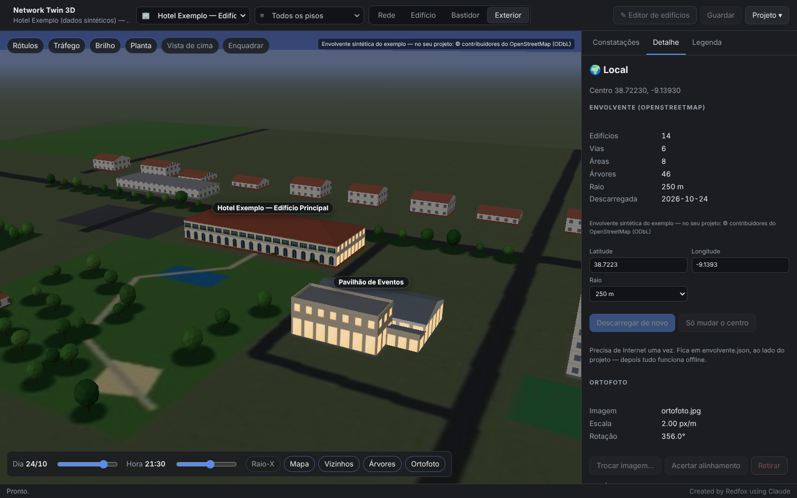

# Network Twin 3D

**Gémeo digital da rede — guia de utilização, ficheiros e formatos**

<!-- Created by Redfox using Claude -->

---

## Índice

1. [Como abrir](#como-abrir)
2. [Ecrãs e vistas](#ecrãs-e-vistas)
3. [Bastidores e sala de servidores](#bastidores-e-sala-de-servidores)
4. [Editor de edifícios (importar plantas)](#editor-de-edifícios-importar-plantas)
5. [Exterior: fotos, alçados, mapa e sol](#exterior-fotos-alçados-mapa-e-sol)
6. [De onde vêm os dados](#de-onde-vêm-os-dados)
7. [`projeto.json`](#projetojson)
8. [`edificio-*.json` — o contrato do edifício](#edificio-json--o-contrato-do-edifício)
9. [`envolvente.json`](#envolventejson)
10. [O que é verificado](#o-que-é-verificado)
11. [Sem janela (linha de comandos)](#sem-janela-linha-de-comandos)
12. [Limites conhecidos](#limites-conhecidos)

---

## Como abrir

### Executável (sem Python)

Na [página das releases](https://github.com/RafaDevpt/Personal-AI-Projects/releases) (`network-twin-3d-v…`), descarregue o do seu sistema, extraia e abra:

| Sistema | Ficheiro | Abrir |
| :--- | :--- | :--- |
| **Windows 10/11** | `…-windows-x64.zip` | `NetworkTwin3D\NetworkTwin3D.exe`. Não está assinado: o SmartScreen pode avisar — *Mais informações → Executar mesmo assim* |
| **macOS** (Apple Silicon) | `…-macos-arm64.zip` | `NetworkTwin3D.app`. Não está assinado: da primeira vez, botão direito → *Abrir* |
| **Linux** (glibc 2.35+, ex.: Ubuntu 22.04) | `…-linux-x64.tar.gz` | `NetworkTwin3D/NetworkTwin3D` (janela via Qt WebEngine, incluído) |

Traz tudo dentro: a interface, o hotel de exemplo e a importação de DXF e PDF. Na linha de comandos: `NetworkTwin3D --validar projeto.json`, ou `--validar --exemplo` para o exemplo que vem dentro. Em Windows o executável é de janela: a linha de comandos devolve o código de saída mas não escreve no ecrã — para ver a lista use o `EXECUTAR.bat`.

**Compilar à mão** (o executável sai para o sistema onde se compila):

```
pip install -r requirements-compilar.txt
python empacotar/compilar.py            → dist/
```

### A partir do código-fonte

| Sistema | Como |
| :--- | :--- |
| **Windows** | Duplo clique em **`EXECUTAR.bat`** (ou arraste um `projeto.json` para cima dele) |
| **macOS** | `./executar.sh` |
| **Linux** | `./executar.sh` — precisa do WebKitGTK: `sudo apt install python3-gi gir1.2-webkit2-4.1` |

Pré-requisito: **Python 3.10+**. Na primeira execução cria o ambiente e instala o `pywebview`. A janela é HTML com Three.js servido **localmente** — não carrega nada da Internet.

**Importar DXF ou PDF** no editor precisa de duas bibliotecas opcionais (imagens funcionam sem elas):

```
.venv\Scripts\pip install -r requirements-importacao.txt      (Windows)
.venv/bin/pip install -r requirements-importacao.txt          (Linux / macOS)
```

No início, **Abrir o hotel de exemplo** mostra tudo a funcionar com dados sintéticos: dois edifícios, sala de servidores com três bastidores, bastidores de piso, plantas em imagem, fachadas fotografadas e um alçado, envolvente, ortofoto, e um erro plantado por tipo de verificação. **Tudo inventado** — nenhum sítio real.

---

## Ecrãs e vistas

### Início — escolher o edifício

Ao abrir um projeto aparece um cartão por edifício, com a planta em miniatura (todos os pisos sobrepostos), o número de pisos, salas, bastidores e equipamentos, e os erros que lá estão. **Clicar num edifício abre-o inteiro**, com todos os pisos.

Há também os cartões **Exterior e local** (os edifícios por fora, no sítio), **Rede lógica** (a rede sem edifício) e **Novo edifício** (abre o editor). O logótipo no canto volta sempre ao início.

### Menus do topo

| Menu | Faz |
| :--- | :--- |
| **🏢 Edifício** | Muda de edifício |
| **≡ Piso** | *Todos os pisos* (empilhados e afastados) ou um piso só — com as paredes à altura real e os nomes das salas |
| **Rede · Edifício · Bastidor · Exterior** | As quatro vistas (atalhos `1` `2` `3` `4`) |

### Vista do edifício

- **Pisos empilhados**, afastáveis com o controlo *Afastar pisos*.
- **A planta original no chão** de cada piso (se o edifício tiver plantas em imagem), com opacidade ajustável. É o que torna o modelo reconhecível.
- **Paredes** tiradas dos polígonos das salas, em vidro fosco para não taparem o interior.
- **Bastidores** à escala real, com as máquinas lá dentro.
- **Cabos** com a cor da pior constatação: sobem à esteira no tecto, ou pela coluna montante entre pisos. Um cabo para **outro edifício** sai pela fachada com a etiqueta `↗ equipamento · edifício` — clicar leva lá. Com um piso só à vista, um cabo para outro piso acaba em `↑ P0 · equipamento`.
- **Clicar numa sala** aproxima a câmara e mostra a sala: área, bastidores, equipamentos, e o formulário **Novo bastidor nesta sala**.
- Botões: *Rótulos*, *Tráfego* (animação nos cabos), *Brilho* (desligar em PCs lentos), *Planta*, *Vista de cima* (`T`), *Enquadrar* (`F`).

### Vista lógica

A rede por camadas — borda → core → distribuição → acesso → APs — sem edifício. Os switches são o mesmo modelo 1U da vista de bastidor, ampliado; os LEDs acesos são as portas activas que o mapper observou.

### Constatações

O painel da direita lista tudo o que o motor encontrou, do pior para o melhor, com filtros por gravidade e procura. **Clicar numa constatação** esbate tudo o resto e leva a câmara ao problema — muda de edifício, se for preciso; num problema de bastidor, abre o bastidor. Cada uma diz **o que fazer**.

---

## Bastidores e sala de servidores

### Criar um bastidor

1. Na vista do edifício, escolher o piso e **clicar na sala** (a sala de servidores, ou o bastidor de piso).
2. No painel: nome e altura (42 U, 24 U, …) → **+ Adicionar bastidor**.
3. Para o pôr no sítio exacto: painel do bastidor → **✥ Mover no mapa** → clicar no chão. A sala é detectada pelo sítio do clique.

Vários bastidores na mesma sala sem posição exacta alinham-se em fila, como numa sala de servidores.

### Montar e desmontar máquinas

**▤ Abrir bastidor** (ou a vista *Bastidor*) mostra o bastidor de perto, sem porta:

- numeração das U no montante;
- cada máquina com etiqueta e linha guia;
- **espaços livres** marcados (`livre U4–U29 · 26U`);
- os outros bastidores da sala ao lado, esbatidos — clicar troca de bastidor.

No painel, a lista de máquinas de cima para baixo com os espaços livres intercalados, e o formulário **Montar máquina**:

| Campo | Notas |
| :--- | :--- |
| Nome, tipo | Switch, router, firewall, servidor, storage, UPS, patch panel, organizador, PDU, KVM, prateleira, outro — cada tipo tem o seu modelo 3D |
| Altura e U | O menu de U só oferece as posições onde a máquina **cabe** |
| Equipamento de rede | Liga a máquina a um equipamento do mapa/perfis: passa a estar **posicionado no bastidor**, com a cor do estado dele, e os cabos dele saem do tampo do bastidor |
| Modelo, n.º de série, nota | Inventário |

Clicar numa máquina permite editá-la (incluindo mudar de U) ou **desmontá-la**. Tudo fica em memória até **Guardar** (aparece *● por gravar* no topo).

A aplicação **recusa** gravar uma máquina sobreposta a outra, fora da altura do bastidor, ou um equipamento de rede montado em dois sítios — com a mensagem a dizer qual é o conflito. Num `projeto.json` editado à mão, os mesmos problemas aparecem como constatações (B03, B04, B08).

---

## Editor de edifícios (importar plantas)

Abre com **✎ Editor de edifícios** (no topo) ou com o cartão **Novo edifício**. Com um edifício aberto na vista, edita esse edifício.

### Com uma planta em imagem (PNG, JPG, WebP) ou PDF

1. **⇪ Importar planta…** — escolhe o ficheiro. Num PDF com várias páginas, a primeira é desenhada; as outras ficam acessíveis.
2. **📏 Calibrar** (`C`) — clicar nas duas pontas de uma medida conhecida (uma parede com cota) e escrever a distância em metros. *Sem escala nada sai em metros.*
3. **⊕ Origem** (`G`) — clicar num canto de referência. **Usar o mesmo canto em todos os pisos** — é o que alinha os pisos entre si em 3D.
4. **✨ Detetar todas as salas** e **⬚ Detetar contorno**. Ou, uma a uma, a **✨ Varinha** (`W`): clicar dentro de uma sala.
5. Corrigir à mão o que falhar (ver *Desenhar e editar*), e dar **nome e tipo** a cada sala na lista à esquerda — o tipo é sugerido pelo nome ("Sala de Servidores" → servidores, "Quarto 214" → quarto…).
6. **⧉ Duplicar** o piso para pisos iguais (torres de quartos): copia salas, contorno e planta; ajusta-se o que muda.
7. **Guardar edifício** — valida tudo antes de escrever e junta o edifício ao projeto aberto.

**Parâmetros da detecção** (painel da direita), em unidades reais:

| Parâmetro | Para quê |
| :--- | :--- |
| Limiar das paredes | O que é escuro o suficiente para ser parede. Plantas a lápis claro: subir |
| Fechar portas até | Aberturas até este tamanho contam como porta (fechadas). Se uma sala se juntar ao corredor: subir |
| Sala mínima | Regiões menores são ruído (cotas, símbolos) |
| Simplificar | Tolerância do contorno |
| Paredes a direito | Arestas quase horizontais/verticais ficam exactas |

O texto das plantas (nomes de salas, cotas) é reconhecido como *não parede* pela forma e ignorado. Um nome **maior do que a própria sala** e encostado às paredes pode fundir-se com elas — nesse caso, desenha-se a sala à mão.

### Com um DXF (AutoCAD)

A via mais fiel: uma polilinha fechada numa camada de salas *é* a sala, com as medidas reais.

1. **⇪ Importar planta…** → o ficheiro `.dxf`.
2. Aparece a lista de **camadas** com polígonos fechados: marcar as que são salas (☑) e, opcionalmente, a do contorno (◉).
3. Se o DXF não disser as unidades, escolher **mm / cm / m**.
4. **Aplicar a este piso** — cada texto (TEXT/MTEXT) que cai dentro de um polígono dá-lhe o nome. Polilinhas minúsculas (pilares, símbolos) são ignoradas.

### Sem planta nenhuma

- **🗺 Contorno OSM…** — escrever as coordenadas do edifício (no Google Maps: botão direito → copiar coordenadas) → *Procurar*. Mostra os edifícios mapeados no OpenStreetMap à volta; **Usar** aplica o contorno ao piso, e **+N pisos** cria logo os pisos (quando o OSM sabe quantos são). Precisa de Internet; dados © contribuidores do OpenStreetMap (ODbL).
- Desenhar as salas sobre a grelha em metros.

### Desenhar e editar

| Ferramenta | Tecla | Uso |
| :--- | :--- | :--- |
| Editar | `V` | Clicar numa sala; arrastar vértices; duplo clique numa aresta acrescenta um vértice; `Delete` apaga o vértice (ou a sala) |
| Retângulo | `R` | Arrastar de canto a canto |
| Polígono | `P` | Clicar nos cantos; `Enter` ou duplo clique fecha; `Backspace` desfaz; `Shift` força ângulos rectos |
| Contorno | `O` | Como o polígono, para o contorno do piso |
| Navegar | — | Roda: zoom. Botão direito, do meio, ou `Espaço` + arrastar: mover. `F`: enquadrar |

Os vértices **encaixam** nos das salas vizinhas — é o que faz duas salas partilharem a mesma parede em 3D. A **pré-visualização 3D** no canto mostra o edifício a crescer à medida que se desenha.

---

## Exterior: fotos, alçados, mapa e sol

### O que é — e o que não é

O exterior é uma **volumetria texturada**: cada edifício é feito de **volumes** (contorno × altura, com cobertura), e em cada parede pode ir a **foto ou o alçado** dessa fachada, com a perspectiva corrigida. É o método do antigo *Building Maker* do Google, e é o que dá um modelo limpo e reconhecível com poucas fotos.

**Não é fotogrametria.** Reconstruir a geometria a partir das fotos (varandas, relevos) precisa de dezenas a centenas de fotos sobrepostas e devolve uma malha suja; com meia dúzia de fotos de telemóvel não funciona, nem localmente nem na nuvem. Aqui, a forma vem das plantas e do OpenStreetMap; as fotos dão a pele.

**O Google Maps não entra:** os termos do Google proíbem guardar os dados dele e usá-los fora da API, e é exactamente isso que uma aplicação local precisa de fazer. O **OpenStreetMap** é aberto (ODbL) e só exige a atribuição, que a aplicação mostra.

### Vista Exterior


| Controlo | Faz |
| :--- | :--- |
| **Dia** e **Hora** | O sol no sítio certo (latitude/longitude do local) e as sombras. Hora do relógio deste computador. De noite acendem-se as janelas desenhadas |
| **Raio-X** | Paredes transparentes: vêem-se os pisos, as salas pela cor do tipo, os **bastidores** e os equipamentos, pintados pelo veredicto (clicáveis) |
| **Mapa · Vizinhos · Árvores · Ortofoto** | Camadas da envolvente. Com a ortofoto à vista, o mapa desenhado sai para não a tapar |



Clicar num edifício mostra os volumes, as coberturas, as fachadas com imagem e os avisos, com **Entrar no edifício** e **✎ Editar exterior…**. Sem nada seleccionado, o painel *Detalhe* mostra o **local**: centro, envolvente, ortofoto e posição do sol.

Cada edifício fica no sítio pela sua **origem** (latitude/longitude do seu (0, 0) e rotação). Um edifício sem coordenadas fica em fila ao lado dos outros, com a etiqueta *sem coordenadas*.


### Editor → separador Exterior


1. **Localização** — latitude, longitude e rotação (graus, a partir do Este, no sentido dos ponteiros do relógio vista de cima). No Google Maps: botão direito no canto do edifício → copiar as coordenadas.
2. **Volumes** — ao entrar, vêm dos pisos acima do chão (pisos seguidos com o mesmo contorno juntam-se). Também:
   - **🗺 Do OSM…** — as partes do edifício (`building:part`) com altura e telhado, quando alguém as mapeou. Altura com `≈` é estimada pelo tipo de edifício;
   - **▭ Volume** (`R`) e **⬠ Volume** (`P`) — desenhar sobre a planta do rés-do-chão; os cantos encaixam nos dos pisos e dos outros volumes. `Alt` desliga o encaixe;
   - **Editar** (`V`) — arrastar vértices, duplo clique numa aresta acrescenta um, `Delete` apaga.
3. **Cobertura** de cada volume — *plana* (com platibanda), *uma água*, *duas águas* (cumeeira no lado longo ou no curto), *quatro águas*. Altura do telhado `0` = automática (30°; 15° em uma água). As inclinadas assentam no retângulo mínimo do volume: se o contorno não for quase retangular (< 85 %), a cobertura fica plana e aparece um aviso — **divida o edifício em volumes retangulares**, que é como os telhados são construídos.
4. **Fachadas** — clicar numa aresta (na planta ou nos botões `0 N`, `1 E`… do volume) → **📷 Foto…** ou **📐 Alçado…** (imagem ou PDF) → marcar os 4 cantos:


| Canto | Onde |
| :--- | :--- |
| **1** | Em baixo à esquerda, como se vê a fachada de frente |
| **2** | Em baixo à direita |
| **3** | Em cima à direita — no **beirado**, onde começa o telhado |
| **4** | Em cima à esquerda |

Arrastam-se os pontos (ou clica-se perto: vai o mais próximo); a **lupa** 4× aparece ao arrastar; as linhas de terços mostram se a perspectiva bate; o **Resultado** atualiza-se. *Aplicar à parede* corrige a perspectiva (homografia) e a imagem fica na parede, à proporção real (até 2048 px). O **original** fica guardado: **⌖ Acertar os cantos…** volta a abrir a ferramenta mais tarde.

**Dicas para as fotos:** o mais de frente possível, fachada inteira e os quatro cantos à vista; sem grande angular extrema (a correcção desfaz a perspectiva, não a curvatura da lente); árvores e carros à frente ficam na textura. Fachada grande demais para uma foto? Use o **alçado** — fica mais limpo.

Paredes sem foto levam **janelas desenhadas por piso**, à altura real de cada piso (desliga-se em *Janelas desenhadas*).

### Envolvente (OpenStreetMap)

Vista Exterior → painel *Detalhe* (sem nada seleccionado) → latitude, longitude, raio (150–1000 m) → **Descarregar do OSM**. Vêm os edifícios vizinhos com altura (`height`, `building:levels`, ou estimada pelo tipo), as vias com largura pelo tipo, verde, floresta (com árvores espalhadas), água, areia, estacionamento, desporto e árvores. Grava-se em **`envolvente.json`** ao lado do projeto — **precisa de Internet uma vez; depois funciona offline**. Os edifícios do próprio projeto saem da envolvente (senão apareciam duas vezes). É preciso gravar o projeto antes.

### Ortofoto

Uma imagem aérea sua (da câmara municipal, de um levantamento por drone, de um serviço de ortofotos) posta no chão. Painel do local → **Escolher imagem…** → alinhar:

- **⌖ Dois pontos** (o mais preciso): clicar num ponto da foto (um canto de um edifício) e depois onde ele devia estar, sobre os contornos; repetir para um segundo ponto, longe do primeiro. Escala, rotação e posição saem dos dois pares.
- **Por coordenadas**: imagem orientada a Norte — latitude do bordo de cima e de baixo, longitude da esquerda e da direita.
- **À mão**: arrastar a foto; acertar escala e rotação nos campos.

Grava-se como `ortofoto.*` ao lado do projeto.

---

## De onde vêm os dados

| Fonte | Ficheiro | Diz |
| :--- | :--- | :--- |
| **Network Topology Mapper** | exportação **JSON** (botão *Guardar JSON*, ou `--json`) | O que **existe**: cabos (e quem os anunciou), portas, VLAN e PoE em produção, pontos finais |
| **Network Config Builder** | perfis `.json` (um por equipamento) | O que **devia existir**: VLANs, modo e VLANs de cada porta |
| **Editor de edifícios** | `edificio-*.json` + `plantas/` + `fachadas/` | **Onde**: edifícios, pisos, salas, plantas; volumes, coberturas e fachadas do exterior |
| **OpenStreetMap** | `envolvente.json` | **À volta**: vizinhos, vias, verde, água, árvores (descarregado uma vez) |
| **Esta aplicação** | `projeto.json` | Liga tudo + cablagem desenhada, bastidores, posições, orçamentos PoE |

Os perfis casam com os equipamentos descobertos pelo **hostname** (sem distinguir maiúsculas) ou pelo **IP de gestão**.

> **Os projetos reais não vão para o repositório.** Juntam topologia, endereços, plantas e a localização de cada bastidor. O `.gitignore` bloqueia `projetos/`, `*.csv`, `plantas/`, `fachadas/`, `envolvente*.json` e `ortofoto.*` fora do exemplo; guarde-os fora daqui. **As fotos das fachadas e a ortofoto mostram o edifício por fora — num hotel, também mostram entradas, câmaras e saídas de serviço.**

---

## `projeto.json`

```json
{
  "formato": 1,
  "tipo": "nettwin-project",
  "nome": "Hotel X",
  "mapa": "mapa-rede.json",
  "perfis": ["perfis/SW-CORE.json", "perfis/SW-P1.json"],
  "edificios": ["edificio-principal.json", "edificio-pavilhao.json"],
  "cablagem": [
    { "a": "SW-CORE", "a_port": "Gi1/0/48", "b": "SW-P1", "b_port": "1/1/48", "nota": "uplink principal" }
  ],
  "equipamentos": {
    "SW-P1":   { "orcamento_poe_w": 370 },
    "FW-EDGE": { "tipo": "router", "camada": "borda" }
  },
  "bastidores": [
    {
      "id": "srv-a1", "nome": "SRV-A1", "edificio": "principal", "piso": "P-1", "sala": "sala-servidores",
      "x": 3.0, "y": 3.0, "rotacao_graus": 0, "altura_u": 42, "largura_mm": 600, "profundidade_mm": 1000,
      "equipamentos": [
        { "nome": "SW-CORE", "tipo": "switch", "u": 39, "altura_u": 1, "equipamento_rede": "SW-CORE", "modelo": "…" },
        { "nome": "UPS", "tipo": "ups", "u": 1, "altura_u": 3 }
      ]
    }
  ],
  "posicoes": {
    "AP-LOBBY": { "edificio": "principal", "piso": "P0", "sala": "lobby" }
  },
  "local": {
    "lat": 38.7223, "lon": -9.1393,
    "envolvente": "envolvente.json",
    "ortofoto": { "imagem": "ortofoto.jpg", "escala_px_m": 2, "origem_px": [504, 484], "rotacao_graus": 356 }
  }
}
```

| Secção | Regras |
| :--- | :--- |
| Caminhos | Relativos à pasta do projeto — a pasta pode mudar de PC |
| `edificios` | Lista de ficheiros. O formato antigo (`"edificio": "…"`, um só) continua a abrir |
| `cablagem` | Opcional. Sem ela, não há verificações de "não documentado" / "em falta" |
| `orcamento_poe_w` | Da **ficha técnica do modelo** — a aplicação nunca o inventa |
| `camada` | `borda`, `core`, `distribuicao`, `acesso`, `ap` — se faltar, é calculada pela topologia |
| `bastidores[].u` | A U **mais baixa** que a máquina ocupa (a U 1 é a de baixo) |
| `bastidores[].x/y` | Metros, opcionais. Sem eles, os bastidores da sala alinham-se em fila |
| `posicoes` | Para equipamentos **fora** de bastidor (APs, switches de secretária). Com um só edifício, `edificio` pode faltar |
| `local` | Opcional. Centro do local (sem ele, vale a origem do primeiro edifício com coordenadas), envolvente e ortofoto. `origem_px` é o pixel da ortofoto que fica no centro; `rotacao_graus` no sentido dos ponteiros do relógio. Ficheiros em falta no disco são aviso, não erro |

---

## `edificio-*.json` — o contrato do edifício

É o que o editor escreve — e o que qualquer outra ferramenta (uma futura importação de BIM, por exemplo) tem de escrever para abrir aqui.

```json
{
  "formato": 1,
  "tipo": "nettwin-building",
  "id": "principal",
  "nome": "Hotel X — Edifício Principal",
  "gerado_por": "planta",
  "origem": { "lat": 38.72, "lon": -9.14, "rotacao_graus": 0 },
  "pisos": [
    {
      "id": "P0", "nome": "Piso 0", "nivel": 0, "altura_m": 4.2,
      "contorno": [[0, 0], [60, 0], [60, 24], [0, 24]],
      "planta": { "imagem": "plantas/principal-P0.png", "escala_px_m": 25, "origem_px": [40, 40] },
      "salas": [
        { "id": "rececao", "nome": "Receção", "tipo": "publica", "poligono": [[0, 0], [14, 0], [14, 10], [0, 10]] }
      ]
    }
  ],
  "exterior": {
    "janelas": true,
    "volumes": [
      {
        "id": "corpo", "nome": "Corpo principal",
        "contorno": [[0, 0], [60, 0], [60, 24], [0, 24]], "base_m": 0, "altura_m": 7.4,
        "cobertura": { "tipo": "quatro_aguas", "altura_m": 3.4, "cumeeira": "longa" },
        "cor_parede": "#ece2cd", "cor_cobertura": "#a65a3d",
        "fachadas": [
          { "lado": 0, "tipo": "foto", "fonte": "IMG_2040.jpg",
            "imagem": "fachadas/principal-corpo-0.jpg", "original": "fachadas/originais/principal-corpo-0.jpg",
            "cantos_px": [[140, 980], [2080, 820], [2080, 560], [140, 330]] }
        ]
      }
    ]
  }
}
```

| Campo | Regras |
| :--- | :--- |
| `id` | Único no projeto; letras, números, `-`, `_`, `.`. Sem ele, usa-se o nome do ficheiro |
| Coordenadas | **Metros**, sistema local do edifício: `x` para a direita, `y` para baixo na planta |
| `nivel` | Inteiro único por piso. `0` rés-do-chão, `-1` cave |
| `cota_m` | Opcional. Sem ela, os pisos empilham-se por nível com as alturas |
| `contorno` | Opcional. Sem ele, usa o rectângulo que envolve as salas |
| `poligono` | ≥ 3 pontos, área não nula, qualquer forma (salas em L servem) |
| `tipo` da sala | `servidores`, `tecnica`, `escritorio`, `publica`, `quarto`, `eventos`, `restauracao`, `circulacao`, `exterior`, `outra` |
| `planta` | Opcional. `imagem` relativa ao ficheiro; `escala_px_m` > 0; `origem_px` = o pixel que é o (0, 0). Imagem em falta no disco não é erro (o piso desenha-se sem ela) |
| `origem` | Opcional. `lat`/`lon` do (0, 0) do edifício e `rotacao_graus` do eixo x a partir do Este, no sentido dos ponteiros do relógio vista de cima |
| `exterior` | Opcional. Sem ele, os volumes saem dos pisos acima do chão, com cobertura plana |
| `volumes[].altura_m` | Da base até ao **beirado**; a cobertura vai por cima. `base_m` serve para volumes em cima de outros |
| `cobertura.tipo` | `plana`, `uma_agua`, `duas_aguas`, `quatro_aguas`. `altura_m` 0 = automática. `cumeeira`: `longa` ou `curta` |
| `cor_*` | `#rgb`, `#rrggbb` ou um nome simples (`beige`) — o que o OSM usa |
| `fachadas[].lado` | A aresta do contorno: do ponto `lado` ao seguinte. Uma fachada por lado |
| `fachadas[].imagem` | Já retificada. `original` + `cantos_px` (inf. esq., inf. dir., sup. dir., sup. esq., em píxeis do original) permitem acertar de novo |

Erros param a leitura com o sítio exacto (ex.: `pisos[0].salas[3].poligono: um polígono precisa de pelo menos 3 pontos`).

---

## `envolvente.json`

Escrito pela aplicação a partir do OpenStreetMap; formato aberto para outra ferramenta escrever.

```json
{
  "formato": 1, "tipo": "nettwin-envolvente", "fonte": "OpenStreetMap",
  "atribuicao": "© contribuidores do OpenStreetMap (ODbL)", "data": "2026-10-24",
  "centro": { "lat": 38.7223, "lon": -9.1393 }, "raio_m": 250,
  "edificios": [ { "contorno": [[…]], "altura_m": 6, "base_m": 0, "cobertura": "duas_aguas", "altura_cobertura_m": 2.2, "estimada": true } ],
  "vias": [ { "linha": [[…]], "largura_m": 6, "tipo": "residential", "nome": "Rua A" } ],
  "areas": [ { "contorno": [[…]], "tipo": "verde" } ],
  "arvores": [[12.5, -40.1]]
}
```

Metros à volta do `centro` (x Este, y Sul), recortados a um quadrado de lado 2 × raio. Tipos de área: `verde`, `floresta`, `agua`, `areia`, `estacionamento`, `desporto`, `pavimento`. Geometria degenerada é posta de lado sem erro.

---

## O que é verificado

| Código | Gravidade | O quê |
| :--- | :--- | :--- |
| **L01** | aviso / info | Cabo visto só de um lado (LLDP desligado numa ponta, ou ponta inalcançável) |
| **L02** | aviso | Cabo existe mas não está na cablagem desenhada |
| **L03** | erro / aviso | Cabo desenhado não encontrado |
| **L04** | aviso | Provável cabo na porta errada |
| **V00** | aviso | Porta do cabo ausente do perfil |
| **V01** | erro | Cabo numa porta desactivada no desenho |
| **V02** | erro | Trunk de um lado, acesso do outro |
| **V03** | erro | VLANs de acesso diferentes nas pontas |
| **V04** | erro | VLAN nativa diferente |
| **V05** | erro | VLAN usada que não atravessa o trunk |
| **V06** | info | VLANs só de um lado do trunk, sem uso hoje |
| **P01** | erro | Porta usa VLAN não declarada no perfil |
| **P02** | aviso | Porta em produção numa VLAN diferente do perfil |
| **P03** | aviso | Porta desligada no desenho mas com ligação activa |
| **P04** | aviso | Ponto final numa VLAN que a porta não serve |
| **E01** | erro / aviso / info | Consumo PoE vs orçamento (> 100 % / > 80 % / sem orçamento) |
| **E02** | aviso | PoE a sair de uma porta com PoE desligado no perfil |
| **R01** | aviso | Ponto único de falha entre comutadores (ponte no grafo; LACP não conta) |
| **D01** | aviso | Perfil sem equipamento na rede |
| **D02** | info | Equipamento sem perfil |
| **D03** | aviso | Equipamento não alcançado pelo mapper |
| **B01** | info | Equipamentos sem posição no edifício |
| **B02** | erro | Posição num edifício, piso ou sala que não existe |
| **B03** | erro | Duas máquinas nas mesmas U de um bastidor |
| **B04** | erro | Máquina fora da altura do bastidor |
| **B05** | erro / aviso | Bastidor num sítio que não existe / fora do polígono da sala |
| **B06** | info | Equipamento com posição no projeto e também num bastidor (vale o bastidor) |
| **B07** | aviso | Máquina ligada a um equipamento de rede que não existe |
| **B08** | erro | O mesmo equipamento de rede montado em dois sítios |
| **M01** | — | Problemas já encontrados pelo mapper |

A cor de cada cabo é a da pior constatação que lhe diz respeito. Verde-acinzentado quer dizer que o cabo existe mas **não havia perfis para comparar a configuração** — um cabo verde a sério foi verificado nas duas pontas.

---

## Sem janela (linha de comandos)

```
EXECUTAR.bat --validar projeto.json
EXECUTAR.bat --validar projeto.json --csv-constatacoes c.csv --csv-cabos cabos.csv
EXECUTAR.bat --cena cena.json projeto.json
```

| Opção | Faz |
| :--- | :--- |
| `--validar` | Lista erros e avisos. Código de saída: **0** sem erros · **1** há erros na rede · **2** não leu o projeto |
| `--csv-constatacoes` | Constatações em CSV (`;`, UTF-8 com BOM — abre bem no Excel) |
| `--csv-cabos` | Lista de cabos: edifício, piso, sala ou bastidor e U, portas e VLANs de cada ponta — para levar ao bastidor |
| `--cena` | A cena 3D em JSON, com as plantas embutidas — abre-se num browser com `index.html?cena=cena.json` (só leitura) |

---

## Limites conhecidos

- O mapper lê a VLAN de acesso de cada porta, não as listas de trunk: as verificações de trunk comparam **desenho contra desenho** nas duas pontas de um cabo real.
- Pontos finais são resumidos por equipamento, não desenhados um a um.
- A detecção de salas em imagem não lê texto (OCR): os nomes dão-se na lista, ou vêm do DXF.
- As fotos dão a **pele** do exterior, não a forma: não há fotogrametria (varandas e relevos ficam planos na textura). A forma vem das plantas, do desenho dos volumes e do OpenStreetMap.
- Coberturas inclinadas só em volumes quase retangulares; telhados complexos fazem-se com vários volumes. Cúpulas e mansardas do OSM ficam planas / de quatro águas.
- O terreno é plano: um hotel em encosta aparece num chão horizontal (use `base_m` para os volumes mais altos).
- A hora do sol é a do relógio deste computador, não a do fuso do local.
- A envolvente vem do OSM tal como está mapeado: alturas em falta são estimadas pelo tipo de edifício (marcadas `≈`).
- Uma base de código para Windows, Linux e macOS (a janela é HTML via pywebview), em vez das três pastas dos outros projetos: aqui o código seria literalmente igual nas três.
