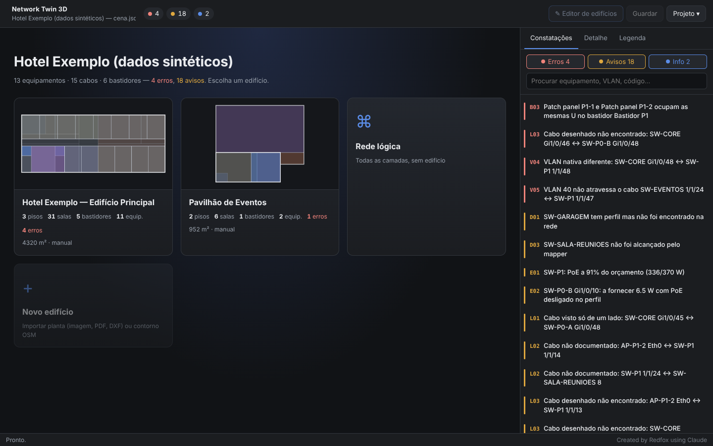
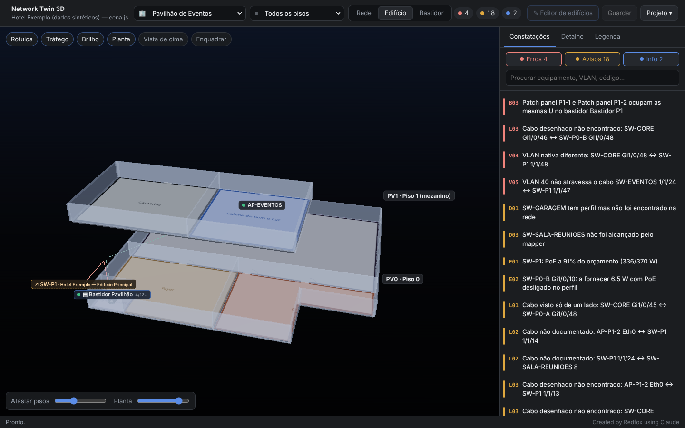
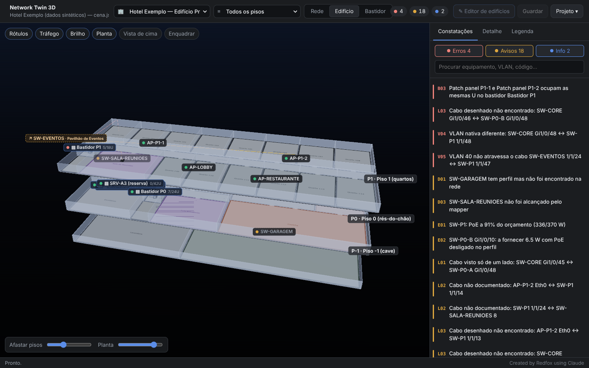
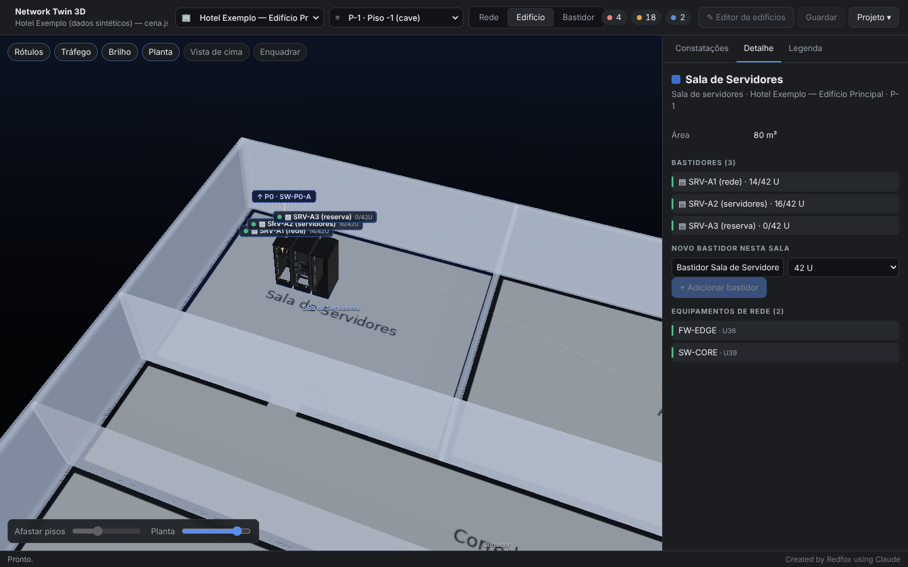
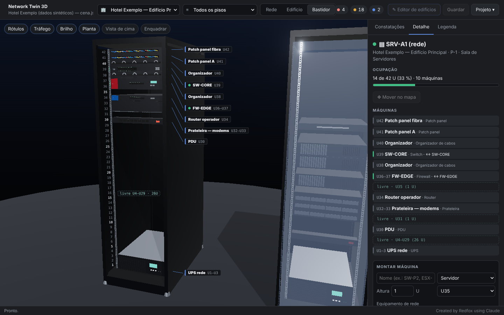
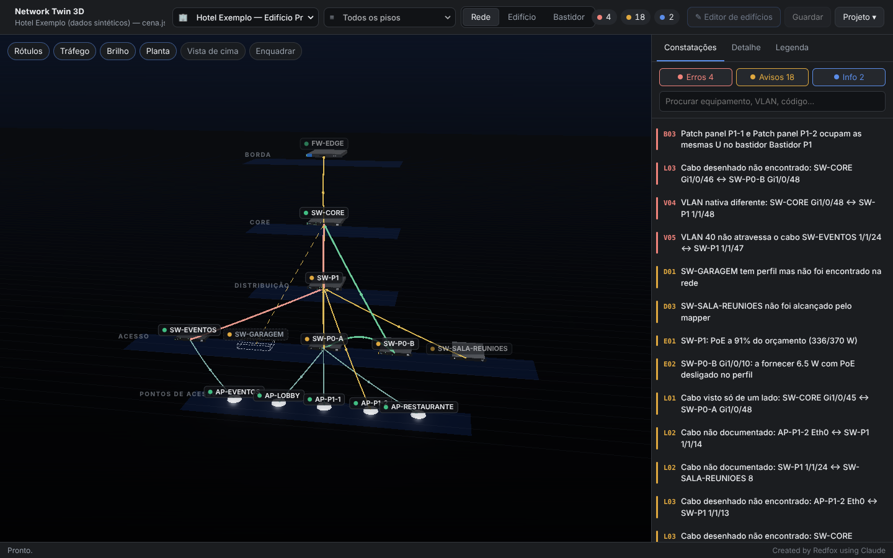
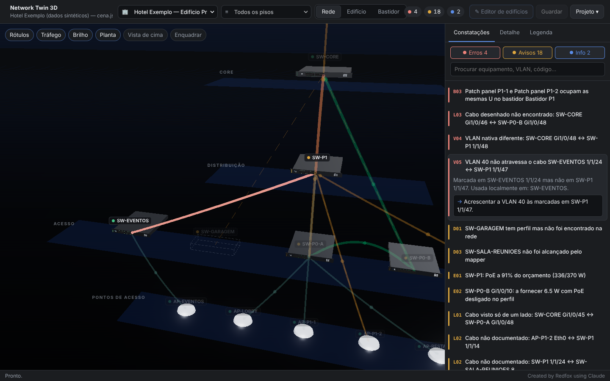
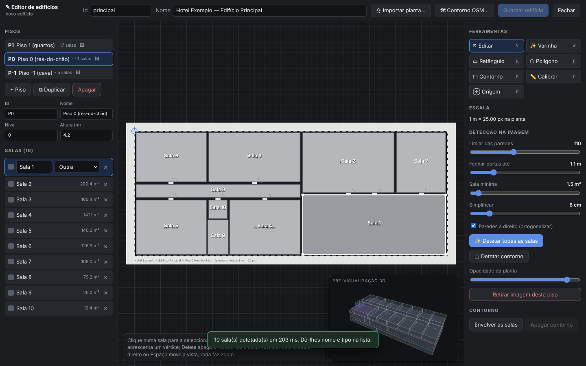

<!--
  Network Twin 3D — README
  Created by Redfox using Claude
-->

<div align="center">

# 🧊 Network Twin 3D

**The network as it is, against the network as it was designed — in 3D, inside the buildings, down to the rack unit, with every cable checked at both ends**


[](https://github.com/RafaDevpt/Personal-AI-Projects/actions/workflows/network-twin-3d.yml)


<a href="https://github.com/RafaDevpt/Personal-AI-Projects"></a>

</div>

---



## What it does

A pretty network diagram proves nothing. What matters is whether each cable, with the configuration it has **at both ends**, actually carries what it should — and where, physically, that cable and those switches are.

Two sibling tools already exist. [Network Topology Mapper](https://github.com/RafaDevpt/network-topology-mapper) walks the network and records **what exists**. [Network Config Builder](https://github.com/RafaDevpt/network-config-builder) holds **what should exist**. Nobody was comparing them, and nobody could see them in the building.

Network Twin 3D does both:

- **Validates** — 30 checks over every cable, port, rack and placement: native VLAN mismatches, VLANs that die on a trunk, trunk on one side and access on the other, designed uplinks that are not there, single points of failure, PoE over budget, machines overlapping in a rack… Every finding comes with the fix.
- **Places** — every switch, AP and rack in its building, floor and room; the original floor plan as the floor texture; racks at real scale with the machines mounted unit by unit.
- **Imports** — floor plans from an image, PDF or **DXF (AutoCAD)**, with automatic room and outline detection, or a building outline from **OpenStreetMap**.

## Start: pick a building

Opening a project shows one card per building — plan thumbnail, floors, rooms, racks, devices, and the errors inside it. **Click a building and the whole building opens.** The top menus switch building and floor at any time.



## Building view



Floors stacked and pulled apart, the original plan on each floor, walls derived from the room polygons, racks with their machines, cables up risers and along ceiling trays. A cable to **another building** leaves through the nearest façade with a clickable `↗` label. Pick a single floor for full-height walls and room names; click a room and the camera flies in.



## Rack view



The rack up close, door off: U numbering, a label column with leader lines, **free ranges marked**, neighbours in the same room alongside. Mount, edit or remove machines — switch, router, firewall, server, storage, UPS, patch panel, PDU, KVM, shelf — each with its own 3D model. A machine linked to a network device takes that device's position and colour, and its cables leave through the rack top. The app **refuses** overlapping machines, machines beyond the rack height, and a device mounted twice.

## Logical view and findings



The network by layers — edge, core, distribution, access, APs — independent of the building. **Click a finding** and everything else dims while the camera goes to the problem (switching building or opening the rack if needed).



## Building editor



The importer that turns plans into the 3D building:

| Source | How |
| :--- | :--- |
| **Image / PDF** | Calibrate the scale (two clicks on a known dimension), set a common origin, then **detect all rooms** or use the **magic wand** room by room, and **detect the outline**. Text and door arcs on the plan are recognised as *not walls* by their shape, so they do not split rooms. |
| **DXF** | Pick the layers that are rooms; closed polylines become rooms with real measurements, and the texts inside them name them. Units from `$INSUNITS` (or chosen). |
| **OpenStreetMap** | Building outlines around a coordinate — and, when OSM knows the number of levels, the floors too. |
| **By hand** | Rectangle and polygon tools on a metre grid, vertex editing, snapping to neighbouring rooms so they share walls, right-angle mode. |

Duplicate a floor for repeated hotel floors. A live 3D preview grows as you draw. Saving validates exactly like reading — the editor never writes a file that will not open.

## Private by construction

- Everything is local: Three.js is vendored, nothing is fetched from the Internet (the optional OpenStreetMap lookup is the only network call, and it says so).
- Real projects never belong in a public repository — they combine topology, addresses, floor plans and the location of every rack. `.gitignore` blocks them; the bundled example is **entirely synthetic**, plans included.

## Installation & usage

```
cd Network-Twin-3D
EXECUTAR.bat                                   # Windows — opens the window
./executar.sh                                  # Linux / macOS
EXECUTAR.bat --validar projeto.json            # headless: exit 0 clean, 1 errors, 2 unreadable
```

DXF and PDF import need two optional libraries: `pip install -r requirements-importacao.txt` (images work without them).

Then **Open the example hotel**. Everything else — data sources, project and building formats, every check, the editor workflow — is in [LEIA-ME](LEIA-ME.md) (Portuguese).

## Requirements on the other tools

Needs the **JSON export** of Network Topology Mapper (format 1), which records which side announced each cable — without it, a cable seen from one side only is indistinguishable from a healthy one.

## Tests

```
pip install -r requirements-dev.txt && python -m pytest      # 98 tests: engine, loaders, racks, bridge, importers
node --test "tests/js/*.test.mjs"                             # room detection on a plan drawn in memory
```

## Known limits

- The mapper reads each port's access VLAN, not trunk allowed lists: trunk checks compare **design against design** on both ends of a real cable.
- Room detection does not read text (no OCR): rooms are named in the list, or by the DXF.
- Photos of a building's **exterior** do not generate the model — that is photogrammetry, a different problem. Plans and OSM outlines do.
- One codebase for Windows, Linux and macOS rather than the three folders of the sibling projects: the window is HTML through pywebview, so the three copies would be identical.

## License

MIT — see the repository [LICENSE](../LICENSE). Three.js is MIT, © three.js authors (`src/nettwin/web/vendor/three/LICENSE`). OpenStreetMap data © OpenStreetMap contributors (ODbL).

---

<div align="center"><sub>Created by Redfox using Claude</sub></div>
