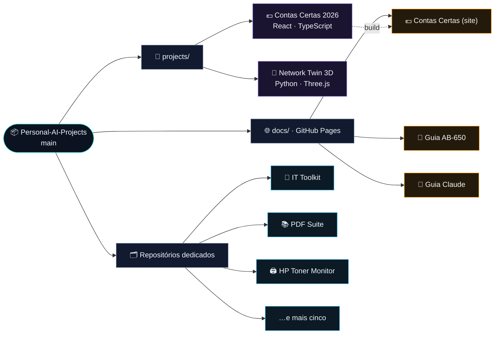
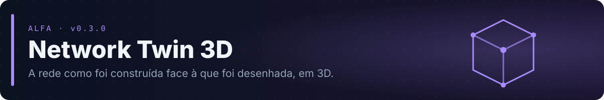

<!--
  PT-PT: Personal-AI-Projects — README principal (índice do repositório).
         O main é o único branch. Os projetos alojados aqui vivem em projects/,
         o site do GitHub Pages vive em docs/, e as ferramentas com repositório
         próprio são apenas referenciadas. Ao acrescentar um projeto, atualizar
         o menu, o mapa e a secção correspondente.
  EN-UK: Personal-AI-Projects — main README (repository index). main is the
         only branch: hosted projects live in projects/, the GitHub Pages site
         lives in docs/, and tools with their own repository are linked.
  Created by Redfox using Claude
-->

<div align="center">



<br />


<a href="https://rafadevpt.github.io/Personal-AI-Projects/"></a>

<br /><br />

<a href="#-network-twin-3d"></a>
<a href="#-contas-certas-2026"></a>
<a href="#-guias-de-estudo"></a>
<a href="#-repositórios-dedicados"></a>
<a href="#-estrutura-do-repositório"></a>

</div>

<br />

## 👋 Sobre este repositório

O **Personal AI Projects** reúne os projetos pessoais do **Redfox**, um gestor de IT com mais de dez anos de experiência em hotelaria de luxo. Cada projeto nasceu de um problema concreto do dia a dia: uma verificação manual repetida todas as semanas, um formulário que ninguém conseguia editar, um relatório escrito à mão. Todos foram construídos com apoio de IA, e todos seguem as mesmas regras: funcionam sem depender de serviços externos sempre que possível, não guardam credenciais nem dados reais, e estão documentados.

O repositório está organizado num único branch, o `main`, com três zonas:

| Zona | O que contém | Onde |
| :--- | :--- | :--- |
| 🧩 **Projetos alojados** | Projetos cujo código vive neste repositório | [`projects/`](projects/) |
| 🌐 **Site publicado** | Guias de estudo e ferramentas web, servidos pelo GitHub Pages | [`docs/`](docs/) · [abrir o site](https://rafadevpt.github.io/Personal-AI-Projects/) |
| 🗂️ **Repositórios dedicados** | Ferramentas maiores, cada uma com repositório, CI e releases próprios | [ver a lista](#-repositórios-dedicados) |

> **EN-UK summary.** Personal AI Projects collects Redfox's personal, AI-assisted projects: IT operations tooling, a 3D digital twin of the network, a Portuguese salary and tax simulator, and interactive study guides. Everything lives on the single `main` branch: hosted code in `projects/`, the GitHub Pages site in `docs/`, and eight larger tools in their own repositories, linked below.

### Mapa



<br />



## 🧊 Network Twin 3D

[](https://github.com/RafaDevpt/Personal-AI-Projects/actions/workflows/network-twin-3d.yml)


O **Network Twin 3D** compara a rede tal como foi construída com a rede tal como foi desenhada, e mostra o resultado em 3D, dentro e fora dos edifícios. Junta o que a ferramenta [Network Topology Mapper](https://github.com/RafaDevpt/network-topology-mapper) encontra no terreno com o que a [Network Config Builder](https://github.com/RafaDevpt/network-config-builder) define, e verifica cada cabo nas duas pontas.

<table>
<tr>
<td width="50%" valign="top">

**O que faz**
- 🔍 **Valida** — 30 verificações sobre cabos, portas, bastidores e posicionamento, cada uma com a correção sugerida
- 🏢 **Posiciona** — cada switch, AP e bastidor no seu edifício, piso e sala, sobre a planta original
- 🗺️ **Importa** — plantas em imagem, PDF ou DXF, e contornos do OpenStreetMap
- ☀️ **Veste o exterior** — fachadas a partir de fotografias, envolvente real e posição do sol

</td>
<td width="50%" valign="top">

**Em resumo**

| | |
| :--- | :--- |
| Sistemas | Windows · Linux · macOS |
| Funciona | Totalmente offline |
| Executáveis | Gerados pelo workflow de release |
| Documentação | [README](projects/network-twin-3d/README.md) · [LEIA-ME](projects/network-twin-3d/LEIA-ME.md) · [CHANGELOG](projects/network-twin-3d/CHANGELOG.md) |

</td>
</tr>
</table>

<p align="center"><a href="projects/network-twin-3d/"></a></p>

<br />


## 💶 Contas Certas 2026

[](https://github.com/RafaDevpt/Personal-AI-Projects/actions/workflows/contas-certas.yml)


A **Contas Certas 2026** é uma aplicação web em português europeu que calcula o salário líquido e simula o IRS de 2026. Todos os cálculos correm no browser: nenhum dado sai do dispositivo. Foi pensada para ser usada pela família, por isso privilegia linguagem simples e ajuda contextual em cada campo.

| 💼 Salário líquido | 🧾 IRS 2026 | 📜 Regras 2026 |
| :--- | :--- | :--- |
| Do bruto para o líquido e ao contrário, com tabelas de retenção de 2026, subsídio de refeição, duodécimos, IRS Jovem e a retenção reduzida de novembro. | Assistente em quatro passos, compara tributação conjunta e separada, e lê a declaração da empresa e o e-fatura (PDF ou captura, com OCR local). | Todos os parâmetros fiscais usados, cada um com a fonte legal. |

<p align="center">
<a href="https://rafadevpt.github.io/Personal-AI-Projects/contas-certas/"></a>
<a href="projects/contas-certas/"></a>
</p>

<br />


## 📚 Guias de estudo


Guias interativos de certificações e cursos, pensados para estudo e para consulta rápida. Cada guia cobre o programa oficial tópico a tópico, com explicação, factos-chave, casos reais, armadilhas comuns e um modo de treino com perguntas de cenário. A leitura foi desenhada para não cansar a vista: tema claro e escuro, três tamanhos de letra e linhas curtas.

| Guia | Conteúdo | Abrir |
| :--- | :--- | :--- |
| 📘 **AB-650** — Microsoft 365 and AI Services Administrator | 58 tópicos, 8 casos reais, 34 armadilhas, 47 perguntas | [abrir →](https://rafadevpt.github.io/Personal-AI-Projects/ab-650/) |
| 🤖 **Claude** — Claude Code 101 · Claude Enterprise · Claude API | 58 tópicos, 8 casos reais, 34 armadilhas, 34 perguntas | [abrir →](https://rafadevpt.github.io/Personal-AI-Projects/claude/) |

<p align="center"><a href="https://rafadevpt.github.io/Personal-AI-Projects/"></a></p>

<br />


## 🗂️ Repositórios dedicados

As ferramentas maiores têm repositório próprio, com CI nos três sistemas operativos e releases versionadas. Cada uma corre em Windows, Linux e macOS.

<table>
<tr>
<td width="50%" valign="top">

### 🔧 [IT Toolkit](https://github.com/RafaDevpt/it-toolkit)
[](https://github.com/RafaDevpt/it-toolkit/actions/workflows/ci.yml) [](https://github.com/RafaDevpt/it-toolkit/releases/latest)

Lê os registos de eventos do sistema, assinala as entradas que indicam problemas reais, explica-as e sugere correções, com relatório pronto para ticket.

`Python` · `customtkinter` · `psutil`

</td>
<td width="50%" valign="top">

### 📚 [PDF Suite](https://github.com/RafaDevpt/pdf-suite)
[](https://github.com/RafaDevpt/pdf-suite/actions/workflows/ci.yml) [](https://github.com/RafaDevpt/pdf-suite/releases/latest)

Converte formulários antigos em PDF preenchíveis e compara documentos, como propostas de fornecedores, totalmente offline.

`Python` · `pypdf` · `pdfplumber` · `reportlab`

</td>
</tr>
<tr>
<td width="50%" valign="top">

### 🖨️ [HP Toner Monitor](https://github.com/RafaDevpt/hp-toner-monitor)
[](https://github.com/RafaDevpt/hp-toner-monitor/actions/workflows/ci.yml) [](https://github.com/RafaDevpt/hp-toner-monitor/releases/latest)

Verifica os níveis de toner de um parque de impressoras HP por SNMP e indica o que é preciso substituir.

`Python` · `SNMP` · `openpyxl`

</td>
<td width="50%" valign="top">

### 🩺 [Transcritor Médico PT](https://github.com/RafaDevpt/medical-transcriber-pt)
[](https://github.com/RafaDevpt/medical-transcriber-pt/actions/workflows/ci.yml) [](https://github.com/RafaDevpt/medical-transcriber-pt/releases/latest)

Transcreve offline, em português europeu, gravações de consultas médicas.

`Python` · `faster-whisper`

</td>
</tr>
<tr>
<td width="50%" valign="top">

### 🌐 [Network Config Builder](https://github.com/RafaDevpt/network-config-builder)
[](https://github.com/RafaDevpt/network-config-builder/actions/workflows/ci.yml) [](https://github.com/RafaDevpt/network-config-builder/releases/latest)

Descreve-se o switch uma vez e gera a configuração para Aruba AOS-CX, Cisco IOS, Ubiquiti EdgeSwitch ou UniFi.

`Python` · `netmiko` · `openpyxl`

</td>
<td width="50%" valign="top">

### 🗺️ [Network Topology Mapper](https://github.com/RafaDevpt/network-topology-mapper)
[](https://github.com/RafaDevpt/network-topology-mapper/actions/workflows/ci.yml) [](https://github.com/RafaDevpt/network-topology-mapper/releases/latest)

Percorre a rede a partir de um switch core ou de um controlador UniFi e mapeia o que está ligado em cada porta.

`Python` · `netmiko` · `requests` · `reportlab`

</td>
</tr>
<tr>
<td width="50%" valign="top">

### 🧪 [Laboratório Virtual](https://github.com/RafaDevpt/virtual-lab-builder)
[](https://github.com/RafaDevpt/virtual-lab-builder/actions/workflows/ci.yml) [](https://github.com/RafaDevpt/virtual-lab-builder/releases/latest)

Cria máquinas virtuais de laboratório a partir de imagens oficiais verificadas, dimensionadas ao que o anfitrião pode dispensar.

`Bash` · `PowerShell`

</td>
<td width="50%" valign="top">

### 🖥️ [VMware Fleet Console](https://github.com/RafaDevpt/vmware-fleet-console)
[](https://github.com/RafaDevpt/vmware-fleet-console/actions/workflows/ci.yml) [](https://github.com/RafaDevpt/vmware-fleet-console/releases/latest)

Consola de terminal para vCenter e ESXi: o inventário completo e o estado de saúde num só ecrã.

`Python` · `pyvmomi` · `textual`

</td>
</tr>
</table>

<br />

## 🧭 Estrutura do repositório

```text
Personal-AI-Projects/            ← branch único: main
├── README.md                    ← este índice
├── Assets/                      ← cabeçalho e banners do README
├── projects/
│   ├── network-twin-3d/         ← código, exemplos, testes e empacotamento
│   └── contas-certas/           ← código-fonte da aplicação web (React + Vite)
├── docs/                        ← site do GitHub Pages
│   ├── index.html               ← página inicial dos guias e ferramentas
│   ├── ab-650/                  ← guia AB-650
│   ├── claude/                  ← guia Claude Code · Enterprise · API
│   └── contas-certas/           ← build publicado da Contas Certas (gerado)
└── .github/workflows/           ← CI do Network Twin 3D e build da Contas Certas
```

Versões antigas de projetos que já têm repositório próprio estão preservadas como **tags** `archive/…`, em vez de branches, para manter o histórico sem poluir o repositório.

## 🧱 Princípios comuns

| Princípio | Na prática |
| :--- | :--- |
| 🔌 **Offline primeiro** | Nada depende de uma API externa quando uma regra local resolve |
| 🛡️ **Seguro por omissão** | Operações de leitura, salvo indicação explícita em contrário |
| 🔐 **Sem segredos** | Nenhuma credencial, dado pessoal ou dado de trabalho em nenhum repositório; a configuração vem de variáveis de ambiente e os exemplos são fictícios |
| 🖥️ **Três sistemas** | As ferramentas correm em Windows, Linux e macOS, com CI em cada um |
| 📖 **Documentado** | Cada projeto tem README, requisitos e capturas de ecrã |

## ⚖️ Licença

Publicado sob a licença MIT — ver [LICENSE](LICENSE). Cada repositório dedicado indica a sua própria licença.

<br />

<div align="center">


</div>
