<!--
  PT-PT: Personal-AI-Projects — README do hub.
         O `main` não contém código de aplicação: é o índice. Cada projeto vive
         no seu próprio repositório, com o seu README, CI, releases e ciclo
         de vida. A tabela de repositórios abaixo tem de corresponder aos
         repositórios públicos — se divergir, o Quick Start deixa de
         funcionar para quem clonar.

  EN-UK: Personal-AI-Projects — hub README.
         `main` carries no application code: it is the index. Each project
         lives in its own repository with its own README, CI, releases and
         lifecycle. The repository table below must match the public
         repositories — if it drifts, the Quick Start stops working.

  Created by Redfox using Claude
-->

<div align="center">



<br /><br />

<!-- ── Core stack ─────────────────────────────── -->


<br />

<!-- ── Live repo telemetry ────────────────────── -->


<br /><br />

<a href="#-project-index"></a>
<a href="#repositories"></a>
<a href="#-getting-started"></a>

</div>


## 🧭 Overview

> **A collection of personal AI-assisted projects built to automate tasks, improve productivity and support both professional and personal activities.**

Every tool here started as a real friction point in day-to-day hospitality IT operations — a manual check repeated 24 times, a form nobody could edit, a report someone typed by hand every Monday — and ended up as a small, self-contained application.

<div align="center">

| 🎯 Principle | What it means in practice |
| :--- | :--- |
| **Offline first** | No external API dependency where a rule-based approach will do.<sup>[1](#nota-offline)</sup> |
| **Safe by default** | Read-only operations unless explicitly told otherwise |
| **Single-file deploy** | A launcher and a folder — no installers, no admin rights |
| **Three versions, one per system** | Every project ships `Windows/`, `Linux/` and `macOS/` folders — each a complete, self-contained application with its own `src/`, tests and launcher. No operating-system branching inside any of them: a test in each version fails if somebody adds one<sup>[2](#nota-tres)</sup> — Network Twin 3D is the one exception<sup>[4](#nota-twin)</sup> |
| **Documented** | Every repository ships its own README, requirements and screenshots |
| **Bilingual source** | Every module, class and function documented in PT-PT and EN-UK |

</div>

<a name="nota-offline"></a>
<sub>

**[1]** One deliberate exception: the **PDF Suite** carries an optional model-assisted analysis that sends document text to the Anthropic API. It is **disabled by default**, it states how many documents and characters will leave the machine before sending anything, and everything it returns is labelled as coming from the model. Every other feature of every project runs entirely offline.

*Uma excepção deliberada: a análise assistida do PDF Suite. Está desligada por omissão, avisa antes de enviar, e o que devolve vem sempre identificado como vindo do modelo.*

</sub>


<a name="repositories"></a>

## 🗂️ Repositories

Each project lives in its own repository, with its own CI, releases and issues. This repository is only the index — with one exception, Network Twin 3D, which lives on a branch here.<sup>[4](#nota-twin)</sup>

<div align="center">

| Project | Repository | CI | Latest release |
| :--- | :--- | :--- | :--- |
| 🔧 IT Toolkit — Machine diagnostics suite<sup>[3](#nota-windows)</sup> | [`it-toolkit`](https://github.com/RafaDevpt/it-toolkit) | [](https://github.com/RafaDevpt/it-toolkit/actions/workflows/ci.yml) | [](https://github.com/RafaDevpt/it-toolkit/releases/latest) |
| 📚 PDF Suite — Fillable PDFs + document comparison | [`pdf-suite`](https://github.com/RafaDevpt/pdf-suite) | [](https://github.com/RafaDevpt/pdf-suite/actions/workflows/ci.yml) | [](https://github.com/RafaDevpt/pdf-suite/releases/latest) |
| 🖨️ HP Toner Monitor — HP printer supply monitoring | [`hp-toner-monitor`](https://github.com/RafaDevpt/hp-toner-monitor) | [](https://github.com/RafaDevpt/hp-toner-monitor/actions/workflows/ci.yml) | [](https://github.com/RafaDevpt/hp-toner-monitor/releases/latest) |
| 🩺 Transcritor Médico PT — Offline PT-PT medical dictation | [`medical-transcriber-pt`](https://github.com/RafaDevpt/medical-transcriber-pt) | [](https://github.com/RafaDevpt/medical-transcriber-pt/actions/workflows/ci.yml) | [](https://github.com/RafaDevpt/medical-transcriber-pt/releases/latest) |
| 🌐 Network Config Builder — Switch configuration for Aruba, Cisco and Ubiquiti | [`network-config-builder`](https://github.com/RafaDevpt/network-config-builder) | [](https://github.com/RafaDevpt/network-config-builder/actions/workflows/ci.yml) | [](https://github.com/RafaDevpt/network-config-builder/releases/latest) |
| 🗺️ Network Topology Mapper — Walks the network and maps what is on every port | [`network-topology-mapper`](https://github.com/RafaDevpt/network-topology-mapper) | [](https://github.com/RafaDevpt/network-topology-mapper/actions/workflows/ci.yml) | [](https://github.com/RafaDevpt/network-topology-mapper/releases/latest) |
| 🧪 Laboratório Virtual — Builds virtual machines from verified official images | [`virtual-lab-builder`](https://github.com/RafaDevpt/virtual-lab-builder) | [](https://github.com/RafaDevpt/virtual-lab-builder/actions/workflows/ci.yml) | [](https://github.com/RafaDevpt/virtual-lab-builder/releases/latest) |
| 🖥️ VMware Fleet Console — vCenter and ESXi maintenance from a terminal | [`vmware-fleet-console`](https://github.com/RafaDevpt/vmware-fleet-console) | [](https://github.com/RafaDevpt/vmware-fleet-console/actions/workflows/ci.yml) | [](https://github.com/RafaDevpt/vmware-fleet-console/releases/latest) |
| 🧊 Network Twin 3D — The network as built against as designed, in 3D inside and outside the buildings<sup>[4](#nota-twin)</sup> | [`network-twin-3d`](https://github.com/RafaDevpt/Personal-AI-Projects/tree/network-twin-3d/Network-Twin-3D) *(branch)* | [](https://github.com/RafaDevpt/Personal-AI-Projects/actions/workflows/network-twin-3d.yml?query=branch%3Anetwork-twin-3d) | — |

</div>

All nine run on Windows · Linux · macOS.

<a name="nota-tres"></a>
<sub>

**[2]** The cost is stated up front in every project: **a fix to shared code has to be applied three times.** That is the price of three independent versions rather than one with branches, and it is a deliberate choice — each version reads more simply, carries no code that does not concern it, and a user takes to their machine only what they need. Each project's `CONTRIBUTING.md` carries the `diff` command that confirms the three have not drifted apart.

How much is actually shared varies by project, and the IT Toolkit is the extreme case: there, the three versions share the report format and the module layout and almost nothing else, because reading a Windows event log and reading a systemd journal are not the same job written twice.

CI runs every version on its own native runner — `windows-latest`, `ubuntu-latest`, `macos-latest`. A Linux version tested on a Windows runner proves nothing about what it does on Linux.

</sub>

<a name="nota-windows"></a>
<sub>

**[3]** The IT Toolkit used to be Windows-only, and its `Linux/` and `macOS/` folders held an explanation of why: reading Windows event logs through `wevtutil`, inventory through WMI and SMART through `wmic` is not something you port — porting it would mean writing a different application that does the same job elsewhere.

That explanation was right, and in v4.0.0 the other two applications were written. The Linux version reads the systemd journal, `/proc`, `/sys` and `systemctl`; the macOS version reads the unified log, the crash reports in `DiagnosticReports`, `launchd` and `diskutil`. They share the report format, the eight modules and the shape of the knowledge base — and, unlike the sibling projects, very little code, because there is very little that could honestly be shared.

Each also knows what it *cannot* see, and says so: elevation on Windows, the `systemd-journal` group on Linux, Full Disk Access on macOS. On all three the command runs, returns zero and shows less — and a report that fails to flag that looks like a clean machine.

</sub>

<a name="nota-twin"></a>
<sub>

**[4]** **Network Twin 3D** breaks two rules of this index on purpose. It lives on the [`network-twin-3d`](https://github.com/RafaDevpt/Personal-AI-Projects/tree/network-twin-3d/Network-Twin-3D) branch of this repository rather than in a repository of its own, and it is **one codebase** rather than three folders: the window is HTML and Three.js inside pywebview, so a `Windows/`, `Linux/` and `macOS/` copy would be three identical files. The operating-system differences that remain — file dialogs, line endings of the launchers — are handled by pywebview and `.gitattributes`, and CI still runs the whole suite on the three native runners.

</sub>


## 📦 Project Index

<table>
<tr>
<td width="50%" valign="top">

### [🔧 IT Toolkit](https://github.com/RafaDevpt/it-toolkit)
[](https://github.com/RafaDevpt/it-toolkit)

[](https://github.com/RafaDevpt/it-toolkit/actions/workflows/ci.yml)

Desktop suite for daily IT work. Reads and interprets the system's event record — event logs on Windows, the systemd journal on Linux, the unified log on macOS — detects errors and potential issues, **suggests fixes**, and compiles them into a report.

`Python` · `CustomTkinter` · `WMI` · `systemd` · `launchd`

<details>
<summary><b>Modules</b></summary>

- Dashboard
- Event log analysis + remediation hints
- Network tools
- Quick tools
- Disks
- Services
- Inventory / system info
- Reporting centre

</details>

</td>
<td width="50%" valign="top">

### [📚 PDF Suite](https://github.com/RafaDevpt/pdf-suite)
[](https://github.com/RafaDevpt/pdf-suite)

[](https://github.com/RafaDevpt/pdf-suite/actions/workflows/ci.yml)

Two tools, one interface: turn any PDF into a fillable form, and compare or summarise multiple documents — supplier proposals, reports, contracts — into a single detailed verdict.

`Python` · `pdfplumber` · `pypdf` · `reportlab`

<details>
<summary><b>What it refuses to do</b></summary>

- **Does not invent missing values.** A quote with no stated warranty is not worth zero — it is "does not say", and the criterion is dropped with its weight redistributed.
- **Does not declare a winner on a thin margin.** Below five points in a hundred it says there is no clear winner.
- **Does not convert currencies.** Different currencies means a warning, not a comparison.

</details>

</td>
</tr>
<tr>
<td width="50%" valign="top">

### [🖨️ HP Toner Monitor](https://github.com/RafaDevpt/hp-toner-monitor)
[](https://github.com/RafaDevpt/hp-toner-monitor)

[](https://github.com/RafaDevpt/hp-toner-monitor/actions/workflows/ci.yml)


Queries the embedded web server of every HP printer on the fleet, flags any toner **below 15%**, identifies colour and cartridge reference, archives the usage page as PDF and drafts the reorder e-mail.

`Python` · `SNMP` · `Selenium`

<details>
<summary><b>Collection chain</b></summary>

`LEDM` → `SNMP` → `HTML scrape` → `browser fallback`

Each method falls through to the next, so a proxy or a self-signed certificate warning never stops the run.

It **drafts** the order e-mail as an `.eml` and never sends it: quantities depend on the stock already in the store room, which the tool knows nothing about.

</details>

</td>
<td width="50%" valign="top">

### [🩺 Transcritor Médico PT](https://github.com/RafaDevpt/medical-transcriber-pt)
[](https://github.com/RafaDevpt/medical-transcriber-pt)

[](https://github.com/RafaDevpt/medical-transcriber-pt/actions/workflows/ci.yml)


Turns dictated audio into written text in **European Portuguese**, with a correction layer built for clinical vocabulary — drug names, dosages, abbreviations and units that a general-purpose transcriber gets wrong.

`Python` · `Whisper` · `CustomTkinter`

<details>
<summary><b>Why it runs offline</b></summary>

The audio is clinical. It never leaves the machine: transcription and correction both run locally, with no API call and no upload step anywhere in the pipeline.

</details>

</td>
</tr>
<tr>
<td width="50%" valign="top">

### [🌐 Network Config Builder](https://github.com/RafaDevpt/network-config-builder)
[](https://github.com/RafaDevpt/network-config-builder)

[](https://github.com/RafaDevpt/network-config-builder/actions/workflows/ci.yml)

Describe a switch once — VLANs, ports, services, hardening — and it writes the configuration file in **Aruba AOS-CX**, **Cisco IOS**, **Ubiquiti EdgeSwitch** or **UniFi** syntax. Then reads what is running on the device, diffs it, and pushes.

`Python` · `Netmiko` · `CustomTkinter`

<details>
<summary><b>Safe by default</b></summary>

- **Reads before it writes.** The backup is the entry condition for a push, not an extra. If the read fails, nothing is sent.
- **Simulates by default.** Writing for real needs `--confirmar`, or typing the device's name into the confirmation box.
- **Never writes a password.** Generated files carry a placeholder; credentials live in memory for the session only.
- On **UniFi** the configuration belongs to the controller, so those files carry a warning and no `write memory` — the tool says so rather than pretending otherwise.

</details>

</td>
<td width="50%" valign="top">

### [🗺️ Network Topology Mapper](https://github.com/RafaDevpt/network-topology-mapper)
[](https://github.com/RafaDevpt/network-topology-mapper)

[](https://github.com/RafaDevpt/network-topology-mapper/actions/workflows/ci.yml)


Give it one core switch — or a UniFi controller — and it walks the network on its own, neighbour to neighbour, reading MAC tables, ARP, port state and PoE. Produces the thing nobody has: **every device, which switch and port it is on, and what it appears to be**.

`Python` · `Netmiko` · `LLDP / CDP` · `reportlab`

<details>
<summary><b>How it decides what something is</b></summary>

Every classification carries a **confidence level and the signals behind it**. An AP identified by LLDP is a fact; a "workstation" inferred from an Intel OUI is a fair guess that could be a printer.

When signals disagree, confidence drops and the conflict is recorded — HP makes workstations and printers under the same OUI, and answering "workstation" would be right half the time.

The finding that earns its keep: a port with six MACs and no LLDP neighbour has an **unmanaged switch** on the far side. It explains the loops and the socket that "sometimes drops".

</details>

</td>
</tr>
<tr>
<td width="50%" valign="top">

### [🧪 Laboratório Virtual](https://github.com/RafaDevpt/virtual-lab-builder)
[](https://github.com/RafaDevpt/virtual-lab-builder)

[](https://github.com/RafaDevpt/virtual-lab-builder/actions/workflows/ci.yml)

Builds virtual machines without the two things that go wrong. It fetches the image from the project's **own** servers with the whole verification chain along the way, and works out the specification from what the host actually has — then says **how** it got to the numbers, so you know when to change them.

It **recognises the hypervisor you already paid for** — VMware Workstation, Parallels Desktop, VMware Fusion — and knows how to build machines in it. When none is present, it installs one for you, silently, with the progress on screen. Seventeen images in the catalogue, or bring your own.

`PowerShell` · `bash` · `GPG` · `libvirt` · `QEMU`

<details>
<summary><b>Why the order of the checks matters more than the checks</b></summary>

Domain allowlist re-checked **on every redirect** — following redirects blindly voids the list entirely. HTTPS with no exceptions. GPG signature of the checksum manifest. SHA-256, mandatory, with no off switch.

And the signature is verified **before** the filename is read out of the manifest. The other way round, a tampered manifest could point at anything — and the final checksum would happily confirm that anything matched the value the attacker put there.

**The filename is never invented.** It comes out of the signed manifest, because a name pinned in a catalogue goes stale on the first point release — and a wrong name is indistinguishable from an attack.

The report always says which layers ran. A layer that did not appears as `[--]` rather than being left off: saying "verified" when only a same-channel checksum was compared is a misleading truth.

</details>

<details>
<summary><b>Bring your own image</b></summary>

For a Proxmox, a TrueNAS, an appliance, or the ISO your company hands you. **No guarantees are invented here** — the report shows four layers unapplied and, at best, the checksum.

What it can still do is say **where the file came from**, and each system knows something different: the Mark of the Web on Windows (which often carries the download URL), Gatekeeper's quarantine and `kMDItemWhereFroms` on macOS, `user.xdg.origin.url` on Linux. On all three, no mark means the system does not know — not that the file is safe.

And it knows that **an ISO is the installer while a disk image is the machine**: creating an empty disk beside a `.qcow2` and booting from a CD that is not there gives exactly the *no bootable device* nobody can explain.

</details>

</td>
<td width="50%" valign="top">

### [🖥️ VMware Fleet Console](https://github.com/RafaDevpt/vmware-fleet-console)
[](https://github.com/RafaDevpt/vmware-fleet-console)

[](https://github.com/RafaDevpt/vmware-fleet-console/actions/workflows/ci.yml)

The whole VMware estate on one terminal screen, with no browser and no re-authenticating every time. Connects to a **vCenter** or straight to an **ESXi host**, says whether everything is all right — and handles what comes next: power operations, snapshots, maintenance mode.

`Python` · `pyVmomi` · `Textual` · `vSphere API`

<details>
<summary><b>The certificate, which is where vSphere tooling usually goes wrong</b></summary>

Nearly every ESXi and vCenter presents a self-signed certificate, so nearly everybody writing vSphere automation ends up writing the line that switches verification off. Past that line the connection is **encrypted but not authenticated**: anything in the middle can present itself as the server and take a vSphere administrator password in clear text out of the far end of the tunnel.

This does what SSH does. Validate the chain; if it fails, **do not connect** — show the SHA-256 fingerprint and wait for somebody to compare it against what the server displays, before any credential leaves the machine. Once accepted, it is pinned.

And **a changed fingerprint stops the connection**. That happens when a certificate is regenerated — and it happens when you are not talking to the same server any more. A nuisance once a year, and the difference between noticing a certificate substitution and not noticing one.

</details>

<details>
<summary><b>Shutting down is not powering off, and the difference is never hidden</b></summary>

`ShutdownGuest` asks the guest to shut itself down. `PowerOff` is the wall socket. Both options always appear together with what each one does written beside them — and when VMware Tools are not running, the clean option appears **as a refusal with the reason**, rather than silently disappearing.

Destructive operations have no Yes and No: they have a box where the **object's name** must be typed. A confirm button teaches people to press confirm; typing `SRV-DC01` forces you to read that the machine about to be stopped is called SRV-DC01.

**No password is ever written to disk**, and there is no field for one — a vCenter administrator password opens the whole estate, and encrypting it with a key that also sits on the machine does not fix that, it postpones it.

</details>

<details>
<summary><b>The guard that has already cost hours to people who lacked it</b></summary>

Putting a host into maintenance mode with machines still running on it: in a DRS cluster vCenter migrates them and the task finishes. **Without DRS** — a single host, which is most small sites — the task sits at 2% *forever*, **with no error at all**, waiting for somebody to power the machines off by hand.

So the running machines are counted first, and the warning says how many and what will happen. Same family: a machine whose host is unreachable takes no orders — vCenter still lists it at its last known state, and that is how somebody powers on a machine that was already on.

And the one always learned too late: **a free-licensed ESXi has a read-only API**. It is detected on connect and stated in the header, instead of letting every button fail with a `RestrictedVersion` that says nothing about licences.

</details>

</td>
</tr>
<tr>
<td width="50%" valign="top">

### [🧊 Network Twin 3D](https://github.com/RafaDevpt/Personal-AI-Projects/tree/network-twin-3d/Network-Twin-3D)
[](https://github.com/RafaDevpt/Personal-AI-Projects/tree/network-twin-3d/Network-Twin-3D)

[](https://github.com/RafaDevpt/Personal-AI-Projects/actions/workflows/network-twin-3d.yml?query=branch%3Anetwork-twin-3d)


The other two network tools, put together and put in the building. Crosses what the **Topology Mapper** found (as built) with what the **Config Builder** holds (as designed), and checks every cable **at both ends** — then shows it in 3D: buildings, floors and rooms on the original floor plans, **racks at real scale with every machine in its U**, cables up risers and between buildings. And from outside: **façade photos straightened onto the walls**, real roofs, the surroundings from OpenStreetMap and the sun at any hour.

`Python` · `pywebview` · `Three.js` · `ezdxf` · `OpenStreetMap` · `homography`

<details>
<summary><b>What it checks</b></summary>

30 checks in nine families — links, VLANs, ports, PoE, redundancy, devices, building, racks, and what the mapper itself reported — each with the fix. Native VLAN mismatches, a VLAN that dies on a trunk, trunk on one side and access on the other, designed uplinks that are not there, single points of failure, PoE over budget, two machines in the same U.

Click a finding and everything else dims while the camera flies to the problem — another building, or inside the rack, if that is where it is.

</details>

<details>
<summary><b>From floor plan to 3D building</b></summary>

Plans come in as an **image, PDF or DXF**. Calibrate the scale with two clicks, and it detects every room and the outline on its own — text and door arcs are recognised as *not walls* by their shape, so they do not split rooms. DXF closed polylines become rooms with real measurements; OpenStreetMap gives the outline and, when it knows, the number of floors.

</details>

<details>
<summary><b>From façade photos to the outside of the building</b></summary>

Mark the four corners of a façade on a phone photo — or an elevation drawing — and a **homography** straightens it onto that wall at its real proportions; the original is kept to re-fit later. Walls with no photo get windows drawn per floor, lit at night. Roofs — flat, mono-pitch, gable, hip — come from the editor or from OpenStreetMap `building:part`s.

The surroundings (neighbours with height, roads, green, water, trees) come from **OpenStreetMap once** and then work **offline**. Not Google Maps: its terms forbid storing the data or using it outside its API. An orthophoto of your own goes on the ground, aligned by two points.

The photos are the **skin**, not the shape: this is not photogrammetry, which needs hundreds of overlapping shots and returns a messy mesh. The shape comes from the plans and the volumes — the method of Google's old Building Maker — and it says so rather than pretending.

</details>

<details>
<summary><b>Why it is never published with real data</b></summary>

A project joins the topology, the configuration, the floor plans, the façade photos and the location of every rack — the full map someone would need to attack the network, or to walk into the server room. Real projects stay outside any repository; the bundled hotel is entirely synthetic — plans, façade "photos", surroundings and orthophoto included.

</details>

</td>
<td width="50%" valign="top">

</td>
</tr>
</table>


## ⚡ Getting Started

<details open>
<summary><b>Clone a project</b></summary>

Each project lives in its own repository:

```bash
git clone https://github.com/RafaDevpt/pdf-suite.git
```

Replace `pdf-suite` with `it-toolkit`, `hp-toner-monitor`, `medical-transcriber-pt`, `network-config-builder`, `network-topology-mapper`, `virtual-lab-builder` or `vmware-fleet-console`.

Network Twin 3D lives on a branch of this repository:

```bash
git clone -b network-twin-3d --single-branch https://github.com/RafaDevpt/Personal-AI-Projects.git
cd Personal-AI-Projects/Network-Twin-3D
```

</details>

<details>
<summary><b>Requirements</b></summary>

| Requirement | Version |
| :--- | :--- |
| Windows | 10 / 11 |
| Linux | any current distribution |
| macOS | 11 (Big Sur) or later |
| Python | 3.10+ |
| Dependencies | per project **and per system**, see `requirements.txt` inside each `Windows/`, `Linux/` or `macOS/` folder |

Pick your system's folder first — each is a complete application:

```bash
cd <Project>/Linux                      # or Windows, or macOS
python -m venv .venv
source .venv/bin/activate               # Windows: .venv\Scripts\activate
pip install -r requirements.txt
```

Every project ships a launcher per system that builds the environment on first run, so the manual steps above are only needed for development:

| System | Launcher |
| :--- | :--- |
| Windows | `EXECUTAR.bat` — double-click |
| Linux | `./executar.sh` |
| macOS | `executar.command` — double-click |

On Linux and macOS, a repository cloned by a Windows machine loses the executable bit: `chmod +x executar.sh cli.sh` restores it.

</details>

<details>
<summary><b>Running the tests</b></summary>

```bash
pip install -r requirements-dev.txt && python -m pytest
```

Each project branch is checked on every push by GitHub Actions — see `.github/workflows/ci.yml` on that branch.

</details>

<details>
<summary><b>Run in Docker, or with Terraform</b></summary>

Six projects ship a `Dockerfile` and a Terraform example in their `Linux/` folder. The container runs the **command line**; the graphical interface stays a desktop app, because a container has no screen.

| Branch | Image | Network it needs |
| :--- | :--- | :--- |
| `PDF-Suite` | `local/pdf-suite` | none |
| `Printer-Remote-Toner-Monitor` | `local/toner-monitor` | `host` (SNMP to the printers) |
| `Medical-Audio-to-Text` | `local/transcritor-medico` | only to download the model the first time |
| `Network-Config-Builder` | `local/network-config-builder` | `host` (SSH to the switches) |
| `Network-Topology-Mapper` | `local/network-topology-mapper` | `host` (controller and switches) |
| `VMware-Fleet-Console` | `local/vmware-fleet-console` | reach to vCenter / ESXi |

`IT-Tool-Kit` and `Virtual-Lab-Builder` have no container on purpose: one diagnoses the machine it runs on, the other drives the machine's hypervisor, and inside a container both would see the container instead.

The same pattern in every project:

```bash
cd <Project>/Linux
docker build -t local/<image> .
docker run --rm --user "$(id -u):$(id -g)" -v "$PWD/dados:/dados" local/<image> --help
```

- Everything the app reads or writes lives in `/dados`; mount a folder there.
- `--user` makes the files it writes yours, not the container's.
- The image is hardened by default in the Terraform example: read-only filesystem, no Linux capabilities, `no-new-privileges`, unprivileged user.
- Nothing personal goes into an image or a `.tf` file: inventories are files in `/dados`, passwords are typed at the prompt (`-it`) or passed as environment variables at run time.

With Terraform (≥ 1.6, provider `kreuzwerker/docker`):

```bash
cd <Project>/Linux/terraform
terraform init
terraform apply -var "pasta_dados=./dados" -var "utilizador=$(id -u):$(id -g)" -var 'comando=["--help"]'
docker start -a <image>      # run again with the same settings
terraform destroy
```

Terraform builds the image, rebuilding only when the code or dependencies change, and creates a container that runs once and stops. Each branch's README has the commands for that project.

</details>


## 👤 About

<table>
<tr>
<td valign="top" width="60%">

Built and maintained by **Rafael Santos** — IT Manager in luxury hospitality, working across PMS, POS, networking and compliance, with a habit of turning manual operations into tooling.

These projects are personal work, published under the MIT licence so anyone facing the same problems can reuse them.

<br />

[](https://www.linkedin.com/in/rafaelsantosit/)
[](https://github.com/RafaDevpt)

</td>
<td valign="top" width="40%">

**Working with**


**Focus**

`Automation` · `IT operations`
`Systems integration` · `Compliance`

</td>
</tr>
</table>


<div align="center">

## 📜 License

Distributed under the **MIT License** — see [`LICENSE`](LICENSE).

The same licence applies to every project branch, each of which carries its own copy.

<br />

<sub>Created by Redfox using Claude</sub>


</div>
