<!--
  PT-PT: Personal-AI-Projects — README do hub.
         O `main` não contém código de aplicação: é o índice. Cada projeto vive
         no seu próprio repositório, com o seu README, CI, releases e ciclo de
         vida. A tabela abaixo tem de corresponder aos repositórios reais — se
         divergir, os links deixam de funcionar para quem chega aqui.
  EN-UK: Personal-AI-Projects — hub README.
         `main` carries no application code: it is the index. Each project
         lives in its own repository with its own README, CI, releases and
         lifecycle. The table below must match the real repositories.
  Created by Redfox using Claude
-->

<div align="center">



</div>

# Personal AI Projects

Índice dos projetos pessoais do Redfox, construídos com apoio de IA para automatizar tarefas de IT e do dia a dia. Este repositório não tem código de aplicação: serve de índice, e cada projeto vive no seu próprio repositório.

> **EN-UK summary.** This is the index of Redfox's personal, AI-assisted projects: IT operations tooling (diagnostics, networking, printers, virtualisation, documents) plus a few everyday utilities. No application code lives here — each project has its own repository, linked in the table below.

## Projetos

| Projeto | Descrição | Stack | Estado | Link |
| :--- | :--- | :--- | :--- | :--- |
| **IT Toolkit** | Lê os registos de eventos, assinala as entradas que indicam problemas reais, explica-as e sugere correções, com relatório pronto para ticket. | Python 3.10+, customtkinter, psutil | Estável · v4.0.0 · Windows, Linux, macOS | [`it-toolkit`](https://github.com/RafaDevpt/it-toolkit) |
| **PDF Suite** | Converte formulários antigos em PDF preenchíveis e compara documentos, totalmente offline. | Python 3.10+, pypdf, pdfplumber, reportlab, customtkinter | Em desenvolvimento · v2.0.0 · Windows, Linux, macOS | [`pdf-suite`](https://github.com/RafaDevpt/pdf-suite) |
| **HP Toner Monitor** | Verifica os níveis de toner de um parque de impressoras HP e indica o que é preciso substituir. | Python 3.10+, SNMP, openpyxl, customtkinter | Estável · v3.0.0 · Windows, Linux, macOS | [`hp-toner-monitor`](https://github.com/RafaDevpt/hp-toner-monitor) |
| **Transcritor Médico PT** | Transcrição offline, em português europeu, de gravações de consultas médicas. | Python 3.10+, faster-whisper, customtkinter | Estável · v6.0.0 · Windows, Linux, macOS | [`medical-transcriber-pt`](https://github.com/RafaDevpt/medical-transcriber-pt) |
| **Network Config Builder** | Descreve-se o switch uma vez e gera a configuração para Aruba AOS-CX, Cisco IOS, Ubiquiti EdgeSwitch ou UniFi. | Python 3.10+, netmiko, openpyxl, customtkinter | Estável · v2.0.0 · Windows, Linux, macOS | [`network-config-builder`](https://github.com/RafaDevpt/network-config-builder) |
| **Network Topology Mapper** | Percorre a rede a partir de um switch core ou de um controlador UniFi e mapeia o que está ligado em cada porta. | Python 3.10+, netmiko, requests, reportlab, customtkinter | Estável · v2.0.0 · Windows, Linux, macOS | [`network-topology-mapper`](https://github.com/RafaDevpt/network-topology-mapper) |
| **Laboratório Virtual** | Cria máquinas virtuais de laboratório a partir de imagens oficiais verificadas, dimensionadas ao que o anfitrião pode dispensar. | Bash, PowerShell | Estável · v1.4.0 · Windows, Linux, macOS | [`virtual-lab-builder`](https://github.com/RafaDevpt/virtual-lab-builder) |
| **VMware Fleet Console** | Consola de terminal para vCenter e ESXi: o inventário completo e o seu estado de saúde num só ecrã. | Python 3.10+, pyvmomi, textual | Estável · v1.0.0 · Windows, Linux, macOS | [`vmware-fleet-console`](https://github.com/RafaDevpt/vmware-fleet-console) |
| **Network Twin 3D** | A rede como foi construída face à que foi desenhada, em 3D, dentro e fora dos edifícios. | Python 3.10+, pywebview, Three.js | Alfa · v0.3.0 · ainda numa branch deste repositório, a aguardar repositório próprio | [branch `network-twin-3d`](https://github.com/RafaDevpt/Personal-AI-Projects/tree/network-twin-3d/Network-Twin-3D) |
| **Contas Certas 2026** | Simulador de salário líquido e assistente de IRS para 2026, em português europeu; os cálculos correm no browser. | TypeScript, Tailwind CSS (Lovable) | Publicado | Código no Lovable (sem repositório) |

## Como usar

Cada projeto instala-se a partir do seu próprio repositório; o README de cada um tem os requisitos, a instalação e a configuração.

```bash
git clone https://github.com/RafaDevpt/pdf-suite.git
```

## Regras deste índice

- Um projeto, um repositório. O hub só guarda esta página.
- Nada de credenciais, dados pessoais, dados de trabalho ou infraestrutura real em nenhum repositório: a configuração vem de variáveis de ambiente (`.env.example`) e os exemplos são fictícios.

## Licença

Este índice é publicado sob a licença MIT — ver [LICENSE](LICENSE). Cada projeto indica a sua própria licença no respetivo repositório.

---

<div align="center">

Created by Redfox using Claude

</div>
