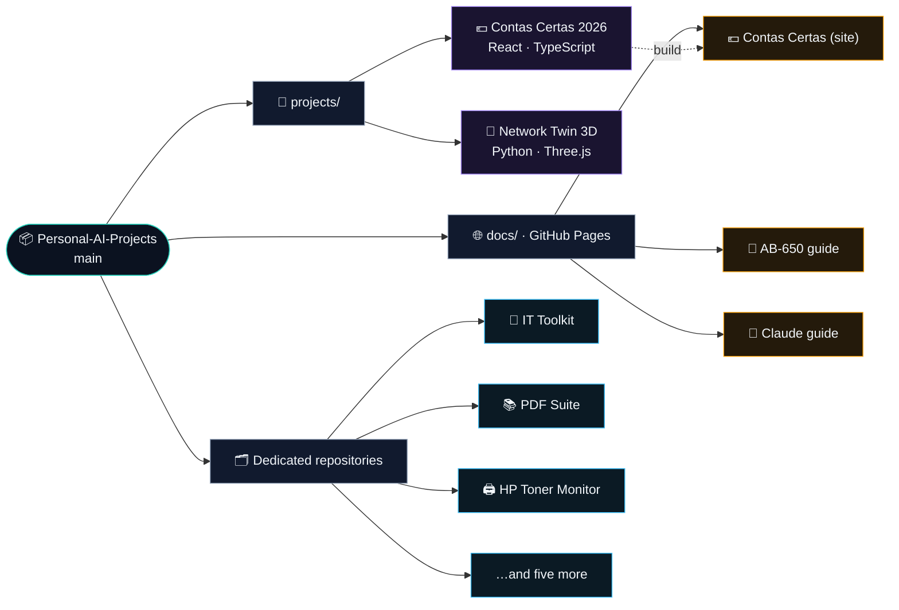
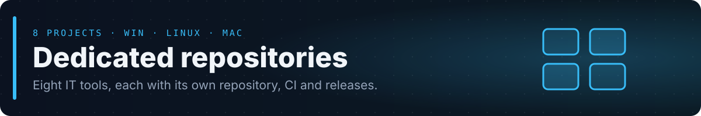

<!--
  Personal-AI-Projects — main README (repository index).
  main is the only branch: hosted projects live in projects/, the GitHub Pages
  site lives in docs/, and tools with their own repository are linked. When a
  project is added, update the menu, the map and the matching section.
  Created by Redfox using Claude
-->

<div align="center">


<br />


<a href="https://rafadevpt.github.io/Personal-AI-Projects/"></a>

<br /><br />

<a href="#-network-twin-3d"></a>
<a href="#-contas-certas-2026"></a>
<a href="#-study-guides"></a>
<a href="#-dedicated-repositories"></a>
<a href="#-repository-structure"></a>

</div>

<br />

## 👋 About this repository

**Personal AI Projects** brings together the personal projects of **Redfox**, an IT manager with more than ten years of experience in luxury hospitality. Each project began with a concrete, everyday problem: a manual check repeated every week, a form nobody could edit, a report written by hand. All of them were built with the help of AI, and all of them follow the same rules: they work without external services wherever possible, they hold no credentials or real data, and they are documented.

The repository is organised on a single branch, `main`, in three areas:

| Area | What it holds | Where |
| :--- | :--- | :--- |
| 🧩 **Hosted projects** | Projects whose code lives in this repository | [`projects/`](projects/) |
| 🌐 **Published site** | Study guides and web tools, served by GitHub Pages | [`docs/`](docs/) · [open the site](https://rafadevpt.github.io/Personal-AI-Projects/) |
| 🗂️ **Dedicated repositories** | Larger tools, each with its own repository, CI and releases | [see the list](#-dedicated-repositories) |

### Map



<br />


## 🧊 Network Twin 3D

[](https://github.com/RafaDevpt/Personal-AI-Projects/actions/workflows/network-twin-3d.yml)


**Network Twin 3D** compares the network as built with the network as designed, and shows the result in 3D, inside and outside the buildings. It combines what [Network Topology Mapper](https://github.com/RafaDevpt/network-topology-mapper) finds on site with what [Network Config Builder](https://github.com/RafaDevpt/network-config-builder) defines, and checks every cable at both ends.

<table>
<tr>
<td width="50%" valign="top">

**What it does**
- 🔍 **Validates** — 30 checks on cables, ports, racks and placement, each with a suggested fix
- 🏢 **Places** — every switch, AP and rack in its building, floor and room, over the original floor plan
- 🗺️ **Imports** — floor plans as images, PDF or DXF, and outlines from OpenStreetMap
- ☀️ **Dresses the exterior** — façades from photographs, the real surroundings and the position of the sun

</td>
<td width="50%" valign="top">

**At a glance**

| | |
| :--- | :--- |
| Systems | Windows · Linux · macOS |
| Works | Fully offline |
| Executables | Built by the release workflow |
| Documentation | [README](projects/network-twin-3d/README.md) · [LEIA-ME (PT)](projects/network-twin-3d/LEIA-ME.md) · [CHANGELOG](projects/network-twin-3d/CHANGELOG.md) |

</td>
</tr>
</table>

<p align="center"><a href="projects/network-twin-3d/"></a></p>

<br />


## 💶 Contas Certas 2026

[](https://github.com/RafaDevpt/Personal-AI-Projects/actions/workflows/contas-certas.yml)


**Contas Certas 2026** is a web application, written in European Portuguese, that works out net salary and simulates the Portuguese 2026 income tax (IRS) return. Every calculation runs in the browser: no data leaves the device. It was designed to be used by family members, so it favours plain language and contextual help on every field.

| 💼 Net salary | 🧾 IRS 2026 | 📜 2026 rules |
| :--- | :--- | :--- |
| Gross to net and back again, with the 2026 withholding tables, meal allowance, twelfths, IRS Jovem and the reduced November withholding. | A four-step assistant that compares joint and separate taxation, and reads the employer's annual statement and e-fatura (PDF or screenshot, with local OCR). | Every tax parameter used, each with its legal source. |

<p align="center">
<a href="https://rafadevpt.github.io/Personal-AI-Projects/contas-certas/"></a>
<a href="projects/contas-certas/"></a>
</p>

<br />


## 📚 Study guides


Interactive guides to certifications and courses, built for study and for quick reference. Each guide covers the official syllabus topic by topic, with an explanation, key facts, real cases, common traps and a practice mode with scenario questions. The reading experience was designed to be easy on the eyes: light and dark themes, three text sizes and short lines.

| Guide | Contents | Open |
| :--- | :--- | :--- |
| 📘 **AB-650** — Microsoft 365 and AI Services Administrator | 58 topics, 8 real cases, 34 traps, 47 questions | [open →](https://rafadevpt.github.io/Personal-AI-Projects/ab-650/) |
| 🤖 **Claude** — Claude Code 101 · Claude Enterprise · Claude API | 58 topics, 8 real cases, 34 traps, 34 questions | [open →](https://rafadevpt.github.io/Personal-AI-Projects/claude/) |

<p align="center"><a href="https://rafadevpt.github.io/Personal-AI-Projects/"></a></p>

<br />



## 🗂️ Dedicated repositories

The larger tools have their own repositories, with CI on all three operating systems and versioned releases. Each one runs on Windows, Linux and macOS.

<table>
<tr>
<td width="50%" valign="top">

### 🔧 [IT Toolkit](https://github.com/RafaDevpt/it-toolkit)
[](https://github.com/RafaDevpt/it-toolkit/actions/workflows/ci.yml) [](https://github.com/RafaDevpt/it-toolkit/releases/latest)

Reads the system event logs, flags the entries that point to real problems, explains them and suggests fixes, with a report ready for a ticket.

`Python` · `customtkinter` · `psutil`

</td>
<td width="50%" valign="top">

### 📚 [PDF Suite](https://github.com/RafaDevpt/pdf-suite)
[](https://github.com/RafaDevpt/pdf-suite/actions/workflows/ci.yml) [](https://github.com/RafaDevpt/pdf-suite/releases/latest)

Turns legacy forms into fillable PDFs and compares documents such as supplier proposals, entirely offline.

`Python` · `pypdf` · `pdfplumber` · `reportlab`

</td>
</tr>
<tr>
<td width="50%" valign="top">

### 🖨️ [HP Toner Monitor](https://github.com/RafaDevpt/hp-toner-monitor)
[](https://github.com/RafaDevpt/hp-toner-monitor/actions/workflows/ci.yml) [](https://github.com/RafaDevpt/hp-toner-monitor/releases/latest)

Checks toner levels across a fleet of HP printers over SNMP and reports what needs replacing.

`Python` · `SNMP` · `openpyxl`

</td>
<td width="50%" valign="top">

### 🩺 [Medical Transcriber PT](https://github.com/RafaDevpt/medical-transcriber-pt)
[](https://github.com/RafaDevpt/medical-transcriber-pt/actions/workflows/ci.yml) [](https://github.com/RafaDevpt/medical-transcriber-pt/releases/latest)

Transcribes recordings of medical consultations in European Portuguese, offline.

`Python` · `faster-whisper`

</td>
</tr>
<tr>
<td width="50%" valign="top">

### 🌐 [Network Config Builder](https://github.com/RafaDevpt/network-config-builder)
[](https://github.com/RafaDevpt/network-config-builder/actions/workflows/ci.yml) [](https://github.com/RafaDevpt/network-config-builder/releases/latest)

The switch is described once, and the configuration is generated for Aruba AOS-CX, Cisco IOS, Ubiquiti EdgeSwitch or UniFi.

`Python` · `netmiko` · `openpyxl`

</td>
<td width="50%" valign="top">

### 🗺️ [Network Topology Mapper](https://github.com/RafaDevpt/network-topology-mapper)
[](https://github.com/RafaDevpt/network-topology-mapper/actions/workflows/ci.yml) [](https://github.com/RafaDevpt/network-topology-mapper/releases/latest)

Walks the network from a core switch or a UniFi controller and maps what is connected to every port.

`Python` · `netmiko` · `requests` · `reportlab`

</td>
</tr>
<tr>
<td width="50%" valign="top">

### 🧪 [Virtual Lab Builder](https://github.com/RafaDevpt/virtual-lab-builder)
[](https://github.com/RafaDevpt/virtual-lab-builder/actions/workflows/ci.yml) [](https://github.com/RafaDevpt/virtual-lab-builder/releases/latest)

Builds lab virtual machines from verified official images, sized to what the host can spare.

`Bash` · `PowerShell`

</td>
<td width="50%" valign="top">

### 🖥️ [VMware Fleet Console](https://github.com/RafaDevpt/vmware-fleet-console)
[](https://github.com/RafaDevpt/vmware-fleet-console/actions/workflows/ci.yml) [](https://github.com/RafaDevpt/vmware-fleet-console/releases/latest)

A terminal console for vCenter and ESXi: the full inventory and its health on a single screen.

`Python` · `pyvmomi` · `textual`

</td>
</tr>
</table>

<br />

## 🧭 Repository structure

```text
Personal-AI-Projects/            ← single branch: main
├── README.md                    ← this index
├── Assets/                      ← README header and banners
├── projects/
│   ├── network-twin-3d/         ← code, samples, tests and packaging
│   └── contas-certas/           ← web application source (React + Vite)
├── docs/                        ← GitHub Pages site
│   ├── index.html               ← home page for the guides and tools
│   ├── ab-650/                  ← AB-650 guide
│   ├── claude/                  ← Claude Code · Enterprise · API guide
│   └── contas-certas/           ← published Contas Certas build (generated)
└── .github/workflows/           ← Network Twin 3D CI and Contas Certas build
```

Earlier versions of projects that now have their own repository are preserved as `archive/…` **tags** rather than branches, which keeps the history without cluttering the repository.

## 🧱 Shared principles

| Principle | In practice |
| :--- | :--- |
| 🔌 **Offline first** | Nothing depends on an external API when a local rule will do |
| 🛡️ **Safe by default** | Read-only operations unless explicitly told otherwise |
| 🔐 **No secrets** | No credentials, personal data or work data in any repository; configuration comes from environment variables and the examples are fictitious |
| 🖥️ **Three systems** | The tools run on Windows, Linux and macOS, with CI on each |
| 📖 **Documented** | Every project has a README, requirements and screenshots |

## ⚖️ Licence

Released under the MIT licence — see [LICENSE](LICENSE). Each dedicated repository states its own licence.

<br />

<div align="center">


</div>
