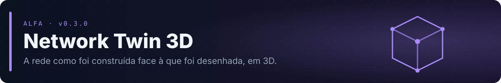

<!--
  projects/ — projects hosted in this repository
  Created by Redfox using Claude
-->

# 🧩 Hosted projects

This folder holds the projects whose code lives in this repository. The larger tools, with a lifecycle of their own, are in [dedicated repositories](../README.md#-dedicated-repositories).

<table>
<tr>
<td width="50%" valign="top">

**🧊 [Network Twin 3D](network-twin-3d/)** — compares the network as built with the network as designed, and shows it in 3D, inside and outside the buildings. A Python desktop application with a Three.js interface, offline, for Windows, Linux and macOS.

`Python` · `pywebview` · `Three.js` · `alpha`

</td>
<td width="50%" valign="top">

**💶 [Contas Certas 2026](contas-certas/)** — a net-salary simulator and 2026 Portuguese income tax (IRS) assistant, in European Portuguese. A static web application; the calculations run in the browser.

`React` · `TypeScript` · `Vite` · `published`

</td>
</tr>
</table>

## Conventions

- Every project has its own `README.md`, requirements and instructions for running it locally.
- Every project has its own workflow in [`.github/workflows/`](../.github/workflows/), filtered by the paths of its folder.
- No project holds credentials, personal data or work data; the examples are fictitious.

 

Created by Redfox using Claude

