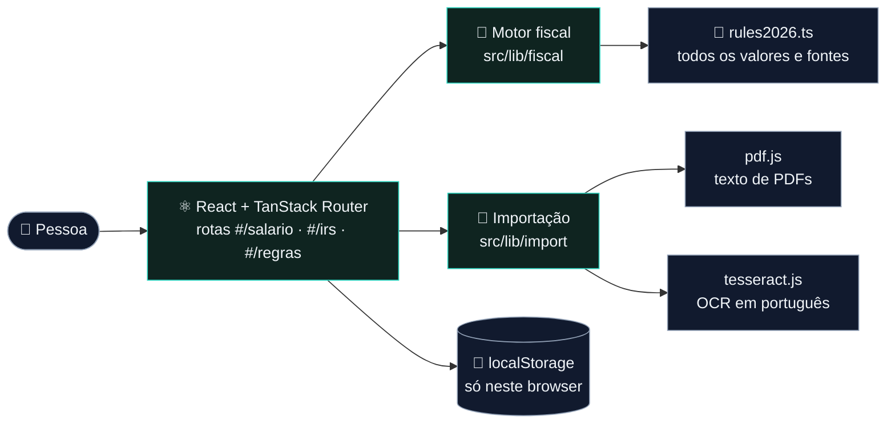
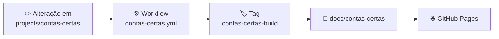

<!--
  Contas Certas 2026 — README
  Created by Redfox using Claude
-->

<div align="center">


[](https://github.com/RafaDevpt/Personal-AI-Projects/actions/workflows/contas-certas.yml)


<a href="https://rafadevpt.github.io/Personal-AI-Projects/contas-certas/"></a>
<a href="../../README.md"></a>

</div>

## 💶 O que é

A **Contas Certas 2026** é uma aplicação web que responde a duas perguntas simples, em português europeu: *quanto se recebe ao fim do mês* e *se, em 2027, a declaração de IRS vai dar reembolso ou imposto a pagar*. Destina-se a pessoas sem formação fiscal, por isso cada campo tem uma explicação curta e os resultados aparecem à medida que se escreve.

Todos os cálculos são feitos no browser. A aplicação não tem servidor, contas nem registos, e os ficheiros que a pessoa carrega (declarações, capturas do e-fatura) são lidos apenas no próprio dispositivo.

> **EN-UK summary.** A Portuguese (Portugal) net-salary and 2026 income-tax simulator. Everything runs in the browser: no server, no accounts, and uploaded files are parsed on the device.

## ✨ Funcionalidades

<table>
<tr>
<td width="33%" valign="top">

### 💼 Salário líquido
- Do bruto para o líquido e do líquido para o bruto
- Tabelas de retenção de 2026 (I, II e III)
- Subsídio de refeição em cartão ou dinheiro
- Duodécimos, IRS Jovem e dependentes
- Retenção reduzida a 50% em novembro de 2026
- Custo total para a empresa

</td>
<td width="33%" valign="top">

### 🧾 IRS 2026
- Assistente em 4 passos
- Compara tributação conjunta e separada
- Lê a declaração anual da empresa (PDF)
- Lê o e-fatura por PDF ou captura (OCR local)
- Deduções, PPR, rendas, incapacidade
- Avisos quando falta informação

</td>
<td width="33%" valign="top">

### 📜 Regras 2026
- Todos os parâmetros fiscais usados
- Cada valor com a fonte legal
- Escalões, tabelas, deduções e limites
- Uma única fonte de valores no código: `rules2026.ts`

</td>
</tr>
</table>

## 🏗️ Arquitetura



| Pasta | Conteúdo |
| :--- | :--- |
| `src/routes/` | As quatro páginas: início, salário, IRS e regras |
| `src/lib/fiscal/` | Motor de cálculo: retenção, salário, IRS e parâmetros de 2026 |
| `src/lib/import/` | Leitura da declaração da empresa e do e-fatura (PDF e OCR) |
| `src/components/` | Campos de formulário, resultados e componentes de interface |
| `scripts/prepare-ocr.mjs` | Copia o motor de OCR para `public/ocr` e descarrega os dados da língua portuguesa |

## 🚀 Publicação



1. Cada alteração em `projects/contas-certas` corre o workflow [`contas-certas.yml`](../../.github/workflows/contas-certas.yml), que instala as dependências, prepara o OCR e compila a aplicação.
2. O resultado fica guardado na tag `contas-certas-build`. A regra de proteção do repositório não deixa o bot do GitHub Actions escrever em branches, por isso o build não é copiado automaticamente.
3. O mantenedor copia o conteúdo da tag para `docs/contas-certas` e faz commit. O GitHub Pages publica a nova versão em poucos minutos.

A aplicação usa rotas por hash (`#/salario`) e caminhos relativos, para funcionar numa subpasta do GitHub Pages sem configuração no servidor.

## 💻 Correr localmente

```bash
cd projects/contas-certas
npm install
npm run prepare:ocr     # motor de OCR e dados da língua portuguesa
npm run dev             # http://localhost:5173
```

## 📌 Origem e limites

- A versão original foi construída no Lovable com TanStack Start (SSR). Esta pasta contém a conversão para uma SPA estática, com o mesmo motor de cálculo e a mesma interface.
- As alterações feitas no Lovable não chegam aqui sozinhas: têm de ser sincronizadas.
- Âmbito: trabalho por conta de outrem (categoria A), residentes no Continente.
- **Simulação indicativa.** O valor que conta é o que as Finanças calcularem no Portal das Finanças.

<br />

<div align="center"><sub>Created by Redfox using Claude</sub></div>
