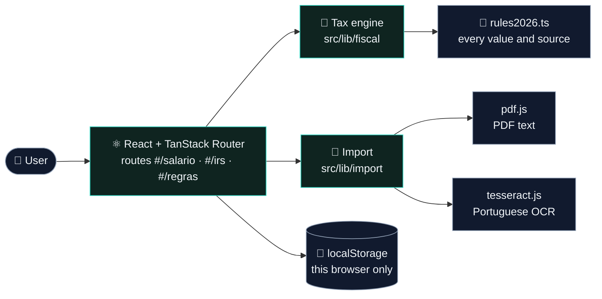
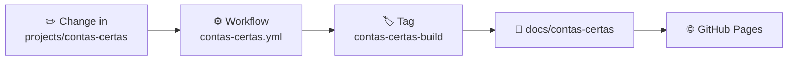

<!--
  Contas Certas 2026 — README
  Created by Redfox using Claude
-->

<div align="center">


[](https://github.com/RafaDevpt/Personal-AI-Projects/actions/workflows/contas-certas.yml)


<a href="https://rafadevpt.github.io/Personal-AI-Projects/contas-certas/"></a>
<a href="../../README.md"></a>

</div>

## 💶 What it is

**Contas Certas 2026** is a web application that answers two simple questions, in European Portuguese: *how much is paid at the end of the month*, and *whether the 2027 income tax (IRS) return will produce a refund or a bill*. It is aimed at people with no tax background, so every field carries a short explanation and the results appear as the user types.

Every calculation happens in the browser. The application has no server, no accounts and no logs, and the files a user uploads (employer statements, e-fatura screenshots) are read only on the user's own device.

## ✨ Features

<table>
<tr>
<td width="33%" valign="top">

### 💼 Net salary
- Gross to net and net to gross
- 2026 withholding tables (I, II and III)
- Meal allowance on card or in cash
- Twelfths, IRS Jovem and dependants
- Withholding reduced by 50% in November 2026
- Total cost to the employer

</td>
<td width="33%" valign="top">

### 🧾 IRS 2026
- A four-step assistant
- Compares joint and separate taxation
- Reads the employer's annual statement (PDF)
- Reads e-fatura by PDF or screenshot (local OCR)
- Deductions, PPR, rent, disability
- Warnings when information is missing

</td>
<td width="33%" valign="top">

### 📜 2026 rules
- Every tax parameter used
- Each value with its legal source
- Bands, tables, deductions and limits
- A single source of values in the code: `rules2026.ts`

</td>
</tr>
</table>

## 🏗️ Architecture



| Folder | Contents |
| :--- | :--- |
| `src/routes/` | The four pages: home, salary, IRS and rules |
| `src/lib/fiscal/` | Calculation engine: withholding, salary, IRS and the 2026 parameters |
| `src/lib/import/` | Reading of the employer statement and e-fatura (PDF and OCR) |
| `src/components/` | Form fields, results and interface components |
| `scripts/prepare-ocr.mjs` | Copies the OCR engine into `public/ocr` and downloads the Portuguese language data |

## 🚀 Publishing



1. Every change in `projects/contas-certas` runs the [`contas-certas.yml`](../../.github/workflows/contas-certas.yml) workflow, which installs the dependencies, prepares the OCR and builds the application.
2. The result is stored in the `contas-certas-build` tag. The repository's protection rule does not allow the GitHub Actions bot to write to branches, so the build is not copied automatically.
3. The maintainer copies the tag's contents into `docs/contas-certas` and commits them. GitHub Pages publishes the new version within a few minutes.

The application uses hash routes (`#/salario`) and relative paths, so it works in a GitHub Pages subfolder with no server configuration.

## 💻 Running locally

```bash
cd projects/contas-certas
npm install
npm run prepare:ocr     # OCR engine and Portuguese language data
npm run dev             # http://localhost:5173
```

## 📌 Origin and limits

- The original version was built in Lovable with TanStack Start (SSR). This folder holds the conversion to a static SPA, with the same calculation engine and the same interface.
- Changes made in Lovable do not reach this folder on their own: they have to be synchronised.
- Scope: employed work (category A), residents of mainland Portugal.
- **Indicative simulation.** The figure that counts is the one the Tax Authority calculates on the Portal das Finanças.

<br />

<div align="center"><sub>Created by Redfox using Claude</sub></div>
